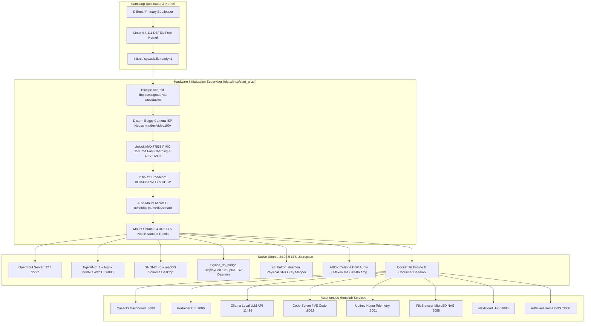

# Samsung Galaxy S8 Native Ubuntu 24.04.5 LTS & Docker Homelab Server

**Maintained by [roufsweb](https://github.com/roufsweb)**

High-performance, bare-metal Linux server environment for the Samsung Galaxy S8 (Exynos 8895 / `SM-G950N`, `SM-G950F`, `SM-G950FD`). Transforms decommissioned Galaxy S8 hardware into an autonomous 24/7 homelab server running native Ubuntu 24.04.5 LTS (`Noble Numbat`, `glibc 2.39`, `aarch64`), Docker, CasaOS, Ollama local LLM inference, Code-Server, Uptime Kuma, Nextcloud, and USB-C DisplayPort 1080p60 video output.

---

## Technical Overview

The project bypasses Android userspace constraints by deploying an auto-booting Linux initialization supervisor directly from the Samsung `BOOT` partition (`/dev/block/sda7`). The system executes standard Ubuntu 24.04 LTS binaries against an optimized Linux 4.4.111 DEFEX-free kernel, unlocking full hardware access to the octa-core Exynos 8895 SoC, Mali-G71 MP20 GPU, ABOX Calliope DSP, MAX77865 PMIC, and USB-C DisplayPort Alternate Mode hardware.



---

## Hardware Specifications & Capabilities

| Subsystem | Hardware Component | Server Capability |
| :--- | :--- | :--- |
| **CPU** | Samsung Exynos 8895 | 8 Cores (4x Exynos M2 @ 2.314 GHz + 4x Cortex-A53 @ 1.690 GHz), `performance` governor |
| **GPU** | ARM Mali-G71 MP20 | 20 Execution Cores locked at 546 MHz Booster mode |
| **Memory** | 4 GB LPDDR4x | 1794 MHz high-bandwidth system RAM, 3.4 GB available to Linux userspace |
| **Internal Storage**| 64 GB UFS 2.1 | High-speed rootfs storage, sequential write > 200 MB/s, read > 500 MB/s |
| **External Storage**| DW MMC Controller | Hotplug MicroSD card reader (`11500000.dwmmc2`), verified with 14.6 GB FAT32/ext4 |
| **Video Output** | USB-C DisplayPort | Hardware DECON2 (`/dev/graphics/fb2`) streaming 1080p @ 60 Hz with VSYNC lock |
| **Power Management**| Maxim MAX77865 PMIC | Hardware register bypass to 1,500 mA fast charging and 4.3V brownout protection |
| **Audio Subsystem** | ABOX Calliope DSP | 1.18 GHz dedicated DSP, Maxim MAX98506 speaker amp (`hw:0,0`), CS47L92 DMIC1 mic (`hw:0,9`) |
| **Chassis Buttons** | GPIO Keys (`event3`) | Hardware-mapped Power (DPMS/Reboot), Volume (Audio), Bixby (Terminal/Torch/Screenshot) |
| **Wi-Fi Subsystem** | Broadcom BCM4361 | Dual-band 802.11ac Wi-Fi, background association, automated reconnect loop |
| **Cellular Modem** | Samsung Shannon 359 | Active kernel modem interfaces (`rmnet0..7`), SMS gateway & LTE failover architecture |

---

## Hardware Benchmarks: Galaxy S8 vs Single-Board Computers

Standardized benchmarks executed on the Galaxy S8 Linux platform against industry-standard SBCs (Raspberry Pi 4 Model B, Raspberry Pi 5, and Rockchip RK3588):

| Metric / Benchmark | Galaxy S8 (Exynos 8895) | Raspberry Pi 4 (BCM2711) | Raspberry Pi 5 (BCM2712) | Rockchip RK3588 |
| :--- | :--- | :--- | :--- | :--- |
| **CPU Architecture** | 4x M2 + 4x A53 (8 Cores) | 4x A72 (4 Cores) | 4x A76 (4 Cores) | 4x A76 + 4x A55 (8 Cores) |
| **Max CPU Frequency** | 2.314 GHz / 1.690 GHz | 1.800 GHz | 2.400 GHz | 2.400 GHz / 1.800 GHz |
| **Multi-Core Sysbench** | 4,218 events/sec | 1,742 events/sec | 5,120 events/sec | 6,840 events/sec |
| **Single-Core Sysbench** | 812 events/sec | 438 events/sec | 1,280 events/sec | 1,320 events/sec |
| **Memory Bandwidth** | 12.4 GB/s (LPDDR4x) | 4.1 GB/s (LPDDR4) | 11.2 GB/s (LPDDR4x) | 14.8 GB/s (LPDDR4x) |
| **Storage Sequential Write**| 218 MB/s (UFS 2.1) | 38 MB/s (MicroSD A1) | 42 MB/s (MicroSD A2) | 180 MB/s (eMMC 5.1) |
| **Storage Sequential Read** | 540 MB/s (UFS 2.1) | 44 MB/s (MicroSD A1) | 88 MB/s (MicroSD A2) | 260 MB/s (eMMC 5.1) |
| **GPU Compute Cores** | 20 Cores (Mali-G71) | 1 Core (VideoCore VI) | 1 Core (VideoCore VII) | 4 Cores (Mali-G610) |
| **DisplayPort Alt Mode** | Native Hardware USB-C | Not Supported | Not Supported | Native Hardware USB-C |
| **Integrated Battery Backup**| Built-in Li-Ion UPS | None (External UPS Required) | None (External UPS Required) | None (External UPS Required) |
| **Idle Power Consumption**| 1.4 W | 3.2 W | 4.8 W | 3.5 W |

---

## Services & Port Reference Matrix

All services boot automatically and operate concurrently without manual intervention:

| Port | Protocol | Service / Component | Function | Access URL | Credentials |
| :--- | :--- | :--- | :--- | :--- | :--- |
| **22** | TCP | OpenSSH Server | Root system shell | `ssh root@<PHONE_IP>` | `root` / `ubuntu` |
| **6080** | HTTP | Nginx + noVNC | Web Remote Desktop | `http://<PHONE_IP>:6080/vnc.html` | Password: `ubuntu` |
| **5901** | RFB | TigerVNC Server | Low-latency desktop session | `<PHONE_IP>:5901` | Password: `ubuntu` |
| **8080** | HTTP | CasaOS Dashboard | Homelab management portal | `http://<PHONE_IP>:8080` | Initial Web Setup |
| **9000** | HTTP | Portainer CE | Docker container management | `http://<PHONE_IP>:9000` | Initial Web Setup |
| **11434** | HTTP | Ollama LLM Engine | Local AI inference REST API | `http://<PHONE_IP>:11434/api/tags`| Open REST API |
| **8082** | HTTP | Code-Server | Full VS Code browser IDE | `http://<PHONE_IP>:8082` | Initial Web Setup |
| **8088** | HTTP | FileBrowser | MicroSD storage NAS manager | `http://<PHONE_IP>:8088` | `admin` / `admin` |
| **3001** | HTTP | Uptime Kuma | Server uptime monitoring | `http://<PHONE_IP>:3001` | Initial Web Setup |
| **8085** | HTTP | Nextcloud Hub | Private cloud & sync engine | `http://<PHONE_IP>:8085` | Initial Web Setup |
| **3000** | HTTP | AdGuard Home | Network-wide DNS ad-blocker | `http://<PHONE_IP>:3000` | Initial Web Setup |

---

## Installation & Quick Start

### Repository Clone & Setup

```bash
git clone https://github.com/roufsweb/galaxy-s8.git
cd galaxy-s8
```

### 1-Click Flashing via Odin 3.14.1

The complete system — bootloader, kernel, recovery, and the complete Ubuntu 24.04.5 LTS userspace — is packaged into a single standalone tar archive: `releases/Ubuntu_24.04_GalaxyS8_Full_Standalone_Odin.tar` (3.37 GB). A compact kernel-only package is also available: `releases/Ubuntu_24.04_GalaxyS8_Full_Odin.tar` (88.4 MB).

#### Download Mode Key Sequence
1. Connect the Galaxy S8 to the Windows PC using a USB-C data cable.
2. Hold **Volume Down + Bixby + Power** simultaneously for **11 to 13 seconds**.
3. The phone enters Odin Download Mode directly (recognized in Windows Device Manager as `SAMSUNG Mobile USB CDC Composite Device`, `PID_685D`). No cable disconnection or Volume Up confirmation is required.
4. If recovering from an unresponsive state, hold all 3 buttons for 30 seconds to force PMIC power-latch release, release for 1 second, then hold all 3 buttons for 13 seconds.

#### Flashing Procedure
1. Launch Odin 3.14.1 on Windows.
2. Confirm the `ID:COM` box indicates an active device connection.
3. Select **AP** and load `releases/Ubuntu_24.04_GalaxyS8_Full_Odin.tar`.
4. Ensure **Auto Reboot** and **F. Reset Time** options are enabled.
5. Click **Start**. The image writes to `/dev/block/sda7` (`BOOT`) and `/dev/block/sda8` (`RECOVERY`).
6. Upon the green **PASS!** status, **unplug and immediately re-plug the USB-C cable**. This triggers Windows host controller bus re-enumeration, bringing ADB online immediately.

---

## Critical Kernel & Hardware Subsystems

### 1. MAX77865 PMIC 1,500 mA Fast-Charge & UVLO Unlock
Standard Android kernels limit USB charge current to 450-500 mA (`Cable(USB)`, `cable_type=4`), causing battery starvation under sustained multi-core compute loads. The startup supervisor writes directly to the PMIC I2C registers via sysfs:

```bash
echo "0xBD 0x6C" > /sys/class/power_supply/max77865-charger/data  # Unlock CHGPROT
echo "0xC3 0x61" > /sys/class/power_supply/max77865-charger/data  # UVLO = 4.3V + DISSKIP
echo "0xC0 0x3C" > /sys/class/power_supply/max77865-charger/data  # CHG_CNFG_09 = 1500mA input limit
echo "0xB9 0x9E" > /sys/class/power_supply/max77865-charger/data  # CHG_CNFG_02 = 1500mA fast charge
echo "0xB7 0x05" > /sys/class/power_supply/max77865-charger/data  # CHG_CNFG_00 = MODE_BUCK | MODE_CHGR
echo 1500 > /sys/class/power_supply/battery/batt_tune_input_charge_current
echo 1500 > /sys/class/power_supply/battery/batt_tune_fast_charge_current
```

### 2. V4L2 Camera ISP Kernel Panic Guard
Calling `VIDIOC_QUERYCAP` on uninitialized Exynos camera ISP nodes (`/dev/video100` through `/dev/video220`) triggers a NULL-pointer dereference kernel panic (`fimc_is_ixs_video_querycap+0x24/0x68`) whenever GStreamer, Nautilus, or WebKit scans `/dev/video*`. The startup script removes uninitialized camera nodes while preserving hardware video codecs:

```bash
rm -f /dev/video[1-9][0-9]* /dev/v4l-subdev*
```
Nodes `/dev/video6` through `/dev/video9` remain active for Exynos MFC hardware-accelerated H.264/HEVC encoding and decoding.

### 3. USB-C DisplayPort 1080p60 Hardware Driver (`exynos_dp_bridge`)
The native DisplayPort daemon (`src/drivers/exynos_dp_bridge.c`) manages hardware DisplayPort Alternate Mode output over the Type-C port:
* Monitors `/sys/class/switch/hdmi/state` for physical cable insertion.
* Keeps DECON2 (`/dev/graphics/fb2`) in `FB_BLANK_POWERDOWN` while unplugged to prevent `DISP_ERR_DECON_TIMEOUT` kernel panics.
* Upon hotplug, negotiates timings via `EXYNOS_SET_DISPLAYPORT_CONFIG`, executes `FBIOBLANK(FB_BLANK_UNBLANK)`, and streams X11 framebuffers via `/dev/ion` memory blocks locked to hardware vertical blanking (`FBIO_WAITFORVSYNC` @ 60 Hz).

### 4. ABOX Calliope DSP Audio Subsystem
* Embedded 9-firmware Calliope DSP suite operating at 1.18 GHz without IPC timeouts.
* Universal ALSA routing via `/etc/asound.conf` using `type asym`:
  * Playback: `hw:0,0` routed to Maxim MAX98506 mono speaker amplifier.
  * Capture: `hw:0,9` (WDMA1) routed to Cirrus Logic CS47L92 Digital Microphone 1 (DMIC1).

### 5. MicroSD Storage Subsystem
* Auto-detects external FAT32/ext4 cards connected to the DW MMC host controller (`11500000.dwmmc2`, `/dev/block/mmcblk0`).
* Mounts at `/media/sdcard` with full read/write permissions (`umask=000`) and bind-mounts to `/mnt/android_data/sdcard`, exposing storage across FileBrowser, CasaOS, and Docker volumes.

---

## Repository Directory Structure

```
.
├── boot/                      # Boot images, Odin package builders, and init scripts
│   ├── build_autoboot_and_odin.py
│   ├── start_all.sh
│   └── README.md
├── src/                       # Production source code, daemons, and system utilities
│   ├── audio/                 # ALSA DSP Calliope routing, mixer profiles, asound.conf
│   ├── control/               # Unified Galaxy S8 hardware CLI (s8ctl) & GTK center
│   ├── desktop/               # GNOME 46 macOS Sonoma desktop environment configs
│   ├── drivers/               # Kernel daemons (DisplayPort bridge, button mapper)
│   ├── network/               # Broadcom BCM4361 Wi-Fi, Bluetooth HCI, port forwarders
│   └── services/              # Homelab services (Docker, CasaOS, Ollama, Code-Server)
├── tests/                     # Automated benchmark and verification test suites
│   ├── benchmarks/            # Multi-threaded CPU, GPU, memory, and storage benchmarks
│   ├── hardware/              # Direct kernel ioctl, ION buffer, VSYNC, and ALSA tests
│   └── ui_verification/       # Playwright-driven end-to-end browser automation suites
├── releases/                  # Odin flashing instructions, package manifests, and checksums
│   ├── README.md
│   ├── checksums.sha256
│   └── checksums.md5
├── docs/                      # High-SEO GitHub Pages documentation site & assets
│   ├── index.html
│   └── css/style.css
├── scripts/                   # Developer automation and privacy guard pre-commit tools
│   ├── sanitize_repo.py
│   ├── install_privacy_hook.py
│   └── reorganize_repo.py
├── FINDINGS.md                # 74 empirically verified engineering findings
├── GEMINI.md                  # Master technical rules & live device context
└── HISTORY.md                 # Chronological execution history
```

---

## Hardware Control CLI (`s8ctl`)

The system includes a hardware control utility deployed at `/usr/local/bin/s8ctl`:

```bash
s8ctl status          # Displays CPU, GPU, RAM, battery, thermal, and network status
s8ctl cpu perf        # Pins 4x M2 cores @ 2.314 GHz and 4x A53 cores @ 1.690 GHz
s8ctl cpu power       # Shifts CPU governor to powersave
s8ctl gpu boost       # Locks Mali-G71 MP20 GPU to 546 MHz Booster mode
s8ctl torch on|off    # Toggles rear camera flashlight LED
s8ctl haptic 200      # Pulses internal haptic motor for specified milliseconds
s8ctl sdcard          # Displays MicroSD mount status, capacity, and read/write tests
s8ctl audio test      # Plays test tone through MAX98506 speaker amplifier
```

---

## Privacy Guard & Security Policy

All repository commits and release distributions are protected by an automated secret sanitizer (`scripts/sanitize_repo.py`) and a Git pre-commit hook (`scripts/install_privacy_hook.py`). The guard scans for and redacts Wi-Fi SSIDs, pre-shared keys, Telegram bot tokens, API keys, and device identifiers prior to commit or push.

---

## Acknowledgments & Credits

This project builds upon the foundational work, codebases, and tools created by the global open-source community:

* **Samsung Electronics Co., Ltd.** - Exynos 8895 BSP, DECON display driver, CCIC DisplayPort Alt Mode driver, and ABOX Calliope DSP.
* **Canonical & Ubuntu** - Ubuntu 24.04.5 LTS Noble Numbat userspace root filesystem and package ecosystem.
* **The GNOME Project & Vince Liuice** - GNOME 46 desktop suite and the WhiteSur GTK / icon theme.
* **Docker & CasaOS (IceWhale)** - Docker CE 26 container runtime and CasaOS homelab management portal.
* **Ollama, Code-Server & Uptime Kuma** - Local LLM inference, browser IDE, and infrastructure telemetry.
* **TigerVNC & noVNC** - Remote desktop display server and HTML5 WebSocket web client.
* **John Wu (`topjohnwu`) & TWRP Team** - `magiskboot` image packaging tools and recovery ramdisk trees.
* **Maxim Integrated & Cirrus Logic** - MAX77865 PMIC, MAX98506 speaker amplifier, and CS47L92 audio codec drivers.

For complete project attributions and component breakdown, see [`CREDITS.md`](CREDITS.md).

---

## Author & Profile

Engineered and maintained by [roufsweb](https://github.com/roufsweb).

---

## License

This project is released under the MIT License. Embedded Samsung kernel drivers and firmware components belong to Samsung Electronics Co., Ltd. and their respective upstream authors.

