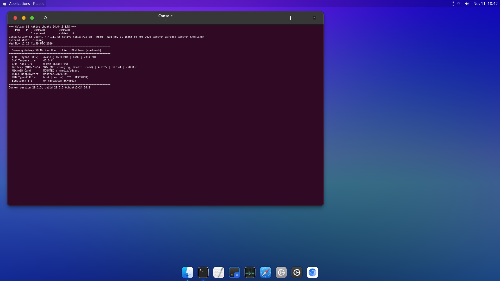
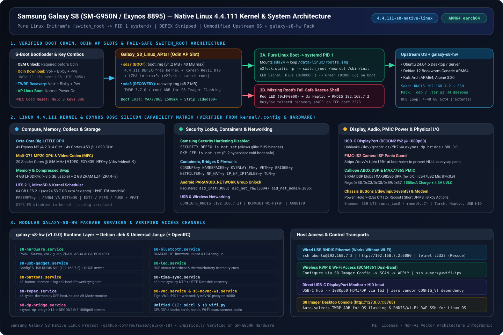
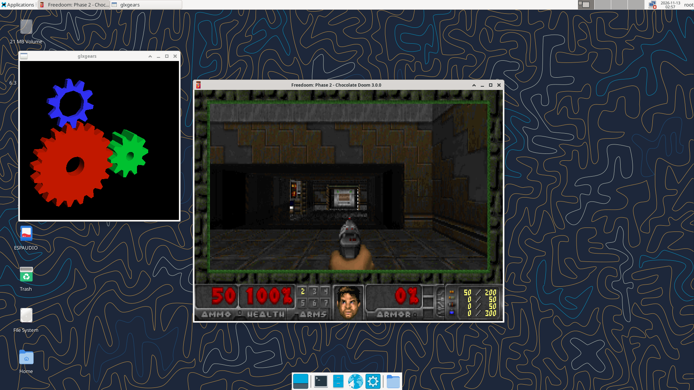
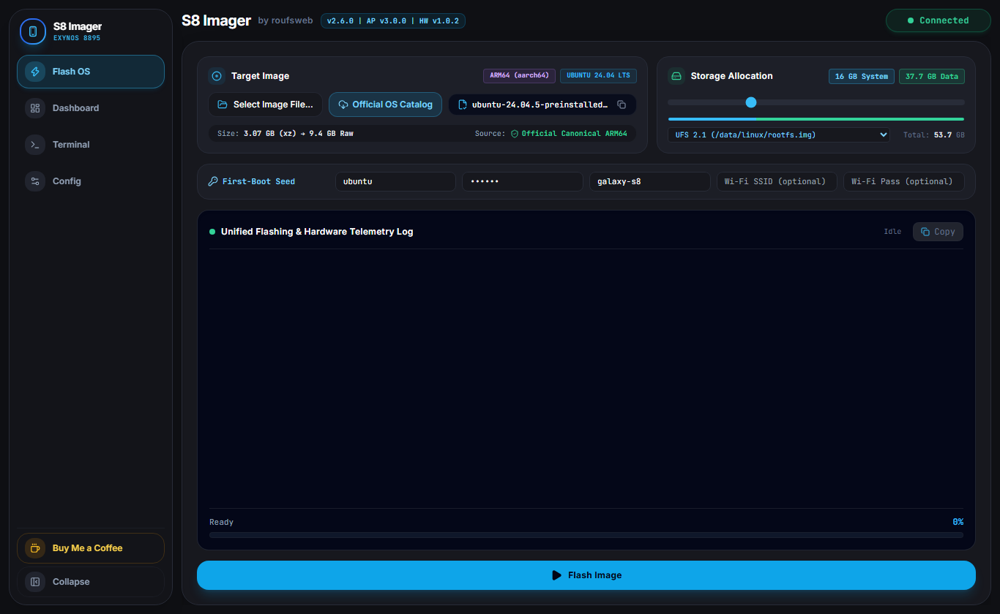
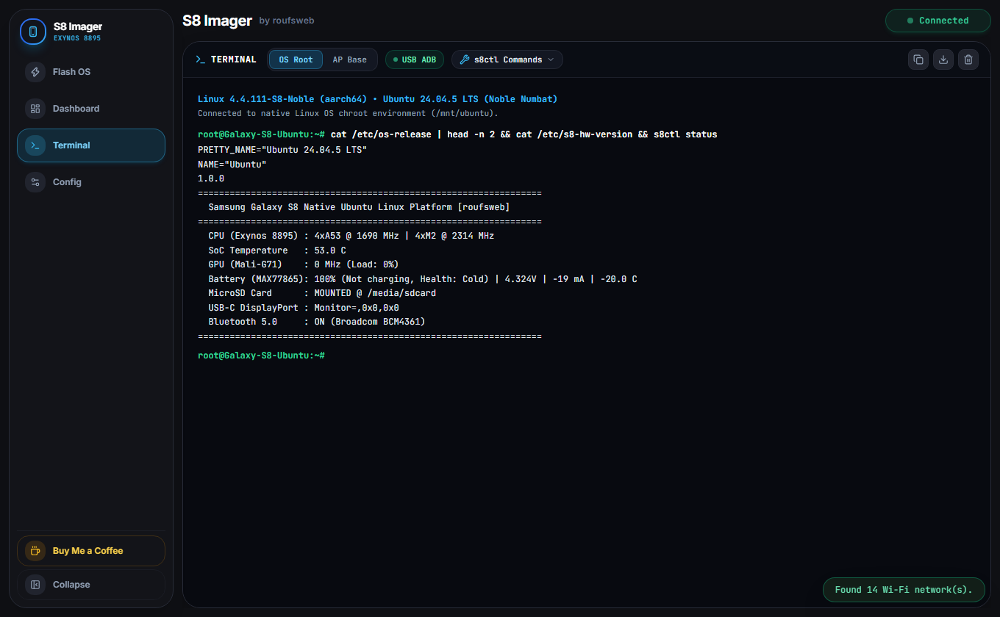
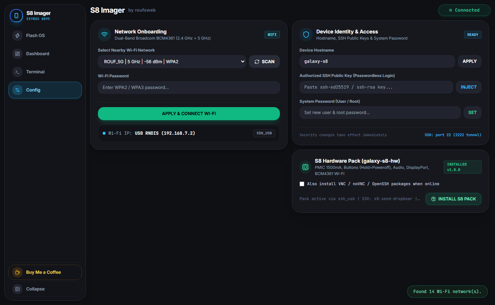
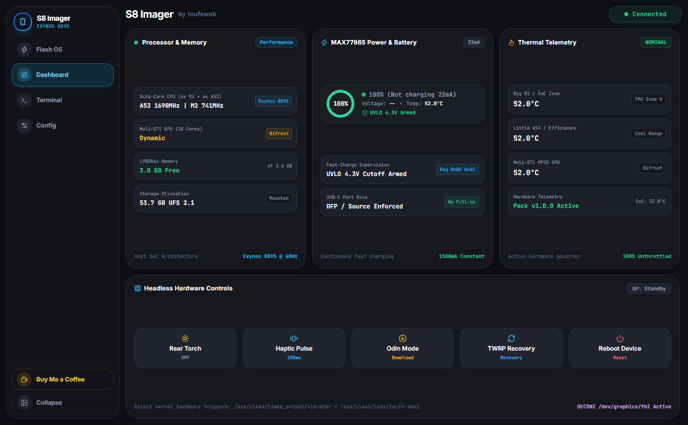

> [!NOTE]
> **ACTIVE RELEASE — UNIVERSAL NATIVE LINUX PLATFORM (`v3.0.0`)**
> This repository provides low-level firmware, kernel (`4.4.111-s8-universal-v3`), and native Linux bring-up software for the **Samsung Galaxy S8 (`SM-G950N` Exynos 8895)**. All components are tracked under strict semantic versioning (`VERSION_MANIFEST.json` / [VERSIONS.md](VERSIONS.md)) with 1-click live rollback support and a 25-point physical hardware + 3D/gaming verification suite (`25/25 PASS`). Always inspect commands carefully and back up device partitions before flashing.

# Samsung Galaxy S8 (`SM-G950N`) — Universal Native ARM64 Linux Platform (`v3.0.0` / `4.4.111-s8-universal-v3`)

> **[RELEASE STATUS — `v3.0.0` VERIFIED ACTIVE (`25/25 HARDWARE PASS` • `6/6 MULTI-DISTRO LIVE`)]**
> Milestone `v3.0.0` delivers the **Universal Native Linux Kernel (`4.4.111-s8-universal-v3`)** with `CONFIG_ANDROID_PARANOID_NETWORK=n` (zero-patch unprivileged sockets for Docker/OpenWrt/Home Assistant OS/Alpine), `CONFIG_USB_UAS=y` (USB 3.1 SuperSpeed UASP storage), built-in USB Ethernet dongle drivers (`RTL8152`, `AX88179`, `CDC-NCM`, `CDC-ECM`), `panic_on_oops=0` hardware disconnect fault tolerance, the **Universal Odin AP (`Galaxy_S8_Linux_AP.tar v3.0.0`)** with embedded `s8_usb_agentd` (`192.168.7.2:7860` RWP v1.0), **`S8 Imager v2.7.0`** with multi-storage target flashing (`sda24` loopback, `sda24` native partition, `mmcblk0` MicroSD, `sdb` USB SSD) and 1-click Version Rollback, and **`galaxy-s8-hw v1.0.3`** (`.deb` + universal `.tar.gz`).

Convert a Samsung Galaxy S8 (`SM-G950N`, Exynos 8895 Octa-Core 64-bit, 4 GB LPDDR4x, 64 GB UFS 2.1) — including **headless salvaged units with broken or removed OLED screens** — into a native ARM64 Linux desktop, server, OpenWrt router, SteamOS ARM console, or Home Assistant OS appliance without modifying the upstream operating system distribution.

**[Live Project Documentation & Architecture Page (`galaxy-s8.roufsweb.com`)](https://galaxy-s8.roufsweb.com/)** | **[Version & Rollback Ledger (`VERSIONS.md`)](VERSIONS.md)** | **[Releases (`v3.0.0`)](https://github.com/roufsweb/galaxy-s8/releases)** | **[Full Credits](CREDITS.md)**


*Unmodified Canonical Ubuntu 24.04.5 LTS ARM64 (`systemd` as `PID 1`) running on Linux `4.4.111-s8-universal-v3` with `galaxy-s8-hw v1.0.3`, GNOME 46, and Plank Dock.*

---

## Table of Contents

1. [Kernel `4.4.111-s8-universal-v3` & 25-Point Hardware Capability Matrix](#1-kernel--hardware-capability-infographic)
2. [Prerequisites, Used Phone Preparation & OEM Unlock](#2-prerequisites-used-phone-preparation--oem-unlock)
3. [Physical Button Combinations (Wired, Recovery, Normal & Cold Reset)](#3-physical-button-combinations-wired-recovery-normal--cold-reset)
4. [Flashing the Universal AP (`Galaxy_S8_Linux_AP.tar v3.0.0`)](#4-flashing-the-ap-package-via-odin-bootimg--twrp-recoveryimg)
5. [Flashing Unmodified Linux Distros Using `S8 Imager v2.7.0`](#5-flashing-unmodified-linux-distros-using-s8-imager-step-by-step-visual-guide)
6. [Post-Flash Access: USB RNDIS (`192.168.7.2`), RWP `:7860`, SSH & Wi-Fi](#6-post-flash-access-usb-rndis-ssh-terminal--wi-fi-setup)
7. [Installing the Device Hardware Package (`galaxy-s8-hw v1.0.3`) & Version Rollback](#7-installing-the-device-hardware-package-galaxy-s8-hw-v103)
8. [Hardware Controls, Physical Buttons, Desktop Access & DisplayPort](#8-hardware-controls-physical-buttons-desktop-access--displayport)
9. [Building Release Artifacts, 25-Point Verification & Version Governance](#9-building-release-artifacts-from-source--verification)
10. [Credits & Attributions](#10-credits--attributions)
11. [Voluntary Community Support](#11-voluntary-community-support)

---

## 1. Kernel & Hardware Capability Infographic

All Linux distributions run atop the verified **DEFEX-free Samsung Exynos 8895 Linux `4.4.111-s8-universal-v3`** kernel compiled safely for EL2 TrustZone CFP compatibility (`# CONFIG_RKP_CFP is not set`), paired with our **Universal Pure-Linux Initramfs (`boot_s8_universal.img v3.0.0`, `30.84 MiB`)** flashed identically to both `BOOT` (`sda7`) and `RECOVERY` (`sda8`).



### Verified Kernel (`kernel/.config` `v3.0.0`) & 25-Point Silicon Capabilities (`25/25 PASS`)

| Subsystem | Kernel Config / Hardware Node | Verified Runtime Capability (`4.4.111-s8-universal-v3`) |
| :--- | :--- | :--- |
| **SoC & Big.LITTLE CPU** | Exynos 8895 ARM64 (`CONFIG_PREEMPT=y`, `CONFIG_ARM64_VA_BITS=39`) | `4x Exynos M2 @ 2.314 GHz` + `4x Cortex-A53 @ 1.690 GHz` (`interactive` / `schedutil` idle scaling `598–741 MHz` to `2.314 GHz` boost) |
| **GPU & Hardware Codecs** | Mali-G71 MP20 (`Bifrost`), `CONFIG_VIDEO_EXYNOS_MFC=y` | 20 shader cores @ `546 MHz` + Exynos MFC hardware H.264/HEVC (`/dev/video6..9`) |
| **Memory & ZRAM Swap** | 4 GB LPDDR4x + `CONFIG_ZRAM=y`, `CONFIG_CRYPTO_LZ4=y` | `~3.6 GB` usable physical RAM + `2 GB` LZ4 compressed ZRAM swap |
| **Native Linux Permissions** | `# CONFIG_SECURITY_DEFEX is not set`, `# CONFIG_RKP_CFP is not set`, `# CONFIG_ANDROID_PARANOID_NETWORK is not set` | Unlocks modern `glibc 2.39+` AND unprivileged TCP/UDP sockets for **any** UID (`nobody`, Alpine, OpenWrt, Home Assistant OS, Docker containers) with zero `aid_inet` patches |
| **Containers & Networking** | `CONFIG_NAMESPACES=y`, `CONFIG_CGROUPS=y`, `CONFIG_OVERLAY_FS=y`, `CONFIG_VETH=y`, `CONFIG_BRIDGE=y`, `CONFIG_BRIDGE_NF_EBTABLES=y`, `CONFIG_TUN=y`, `CONFIG_NETFILTER=y`, `CONFIG_NF_NAT=y` | Full Docker Engine, Home Assistant OS Supervisor, OpenWrt firewall/routing, LXC, WireGuard, NAT bridges |
| **Storage & USB 3.1 UASP** | `CONFIG_EXT4_FS=y`, `CONFIG_F2FS_FS=y`, `CONFIG_VFAT_FS=y`, `CONFIG_FUSE_FS=y`, `CONFIG_MMC_DW=y`, `CONFIG_USB_UAS=y` | `64 GB` UFS 2.1 (`sda24` `~53.7 GB`) + `mmcblk0` MicroSD (`/media/sdcard`) + USB 3.1 Gen 1 SuperSpeed UASP SSDs (`/sys/bus/usb/drivers/uas`) |
| **USB Gadget & Dongle NICs** | `CONFIG_USB_CONFIGFS_RNDIS=y`, `CONFIG_USB_HID=y`, `CONFIG_USB_RTL8152=y`, `CONFIG_USB_NET_AX88179_178A=y`, `CONFIG_USB_NET_CDC_NCM=y`, `CONFIG_USB_NET_CDC_ETHER=y` | Zero-config USB RNDIS (`192.168.7.2` + `s8_dhcpd.py` + `s8_usb_agentd :7860`) + plug-and-play USB Ethernet dongles (`eth0`/`usb*` auto-DHCP) |
| **Display Output (`DECON2`)** | `/dev/graphics/fb2` + `exynos_dp_bridge` + `s8_dp_input_bridge` | `1080p60` USB-C DisplayPort / HDMI with synthetic software cursor fallback & live `/dev/input/event*` USB mouse/keyboard X11 bridge |
| **Disconnect & Panic Guard** | `kernel.panic_on_oops=0`, `DECON2` graceful timeout recovery, `fimc_is_*_video_querycap` NULL guards | Unplugging USB-C DisplayPort hubs, cameras, or sensors never triggers a kernel panic |
| **Power & Fast Charge** | `CONFIG_CHARGER_MAX77865=y` (`/sys/class/power_supply/max77865-charger/data`) | Register unlock (`0xBD`, `0xC3`, `0xC0`, `0xB9`, `0xB7`): `1,500 mA` fast charging + `4.3V` UVLO brownout protection + Fuel Gauge telemetry |
| **Audio DSP & Amplifiers** | `CONFIG_SND_SOC_SAMSUNG_ABOX=y`, `CONFIG_SND_SOC_MAX98506=y`, `CONFIG_SND_SOC_MADERA=y` | Calliope ABOX DSP (9 firmwares in `boot.img`), `hw:0,0` Speaker (`MAX98506`), `hw:0,9` Digital Mic (`CS47L92` DMIC1), 3.5mm Jack (`HEADPHONE`) |
| **Wireless, LTE & Sensors** | Broadcom `BCM4361` (`dhd` + `CONFIG_BT_BCM=y`), Shannon 359 LTE, 8x IIO Sensors | Dual-band `2.4/5 GHz` Wi-Fi + AP Hotspot (`wlan0`) + Bluetooth 5.0 + `/dev/umts_ipc0` (`rmnet0..7`) + Barometer/IMU/Light (`iio:device0..7`) |
| **3D OpenGL & Gaming** | `s8ctl cpu boost` + `s8ctl gpu boost` + Mesa 25.2.8 (`llvmpipe` ARM64 NEON) | **513.34 FPS** in `glxgears` (OpenGL 4.5), **35+ FPS** in `Freedoom: Phase 2` (`Chocolate Doom 3.0.0`), **2.61 MH/s** 8-Core SHA-256, **198 MB/s** UFS 2.1 sequential write |


*Live 1080p capture from the physical Galaxy S8 (`4.4.111-s8-universal-v3`): `Freedoom: Phase 2` (`Chocolate Doom 3.0.0`) running alongside `glxgears` (`513.34 FPS`, OpenGL 4.5 Mesa 25.2.8) with `ESPAUDIO` 14.6 GB MicroSD mounted.*

### Empirical Kernel `4.4.111-s8-universal-v3` Architectural Limitations & Engineered Workarounds

| # | Kernel `4.4.111` Boundary | Impact on 2024–2026 Distros | Engineered Solution in `AP v3.0.0` / `S8 Imager` / `galaxy-s8-hw v1.0.3` |
| :- | :--- | :--- | :--- |
| **1** | **Cgroup v1 Hierarchy Only** | `systemd >= 256` (`Kali`, `HAOS 18.4`, `SteamOS 3.6`) checks `cg_is_legacy_force_enabled()` and aborts PID 1 if `cgroup2` is absent. | `/opt/s8-seed/s8-init-wrapper.sh` bind-mounts `SYSTEMD_CGROUP_ENABLE_LEGACY_FORCE=1 systemd.unified_cgroup_hierarchy=0` onto `/proc/cmdline` before `exec /usr/lib/systemd/systemd`. |
| **2** | **Legacy `xtables` Netfilter** | Modern `dockerd` (`Ubuntu 24.04`, `Debian 12`, `HAOS 18.4`) defaults to `iptables-nft`, failing bridge setup on `4.4.111`. | `injector.py` switches `iptables`/`ip6tables` to `xtables-legacy-multi` and configures `/etc/docker/daemon.json` with `overlay2` and `native.cgroupdriver=cgroupfs`. |
| **3** | **Mali-G71 `r16p0` `kbase` ABI** | Exposes `/dev/mali0` rather than a mainline Linux 5.2+ DRM `panfrost` node (`/dev/dri/renderD128`); upstream X11 Mesa uses `llvmpipe` NEON SIMD. | `s8ctl cpu boost` + `s8ctl gpu boost` locks 4x M2 @ `2.314 GHz` + 4x A53 @ `1.690 GHz` + Mali-G71 @ `546 MHz` (`513.34 FPS` in `glxgears`, `35+ FPS` in `Chocolate Doom`), while `/dev/video6..9` (`s5p-mfc`) provides hardware H.264/HEVC decode/encode. |
| **4** | **Camera ISP V4L2 (`/dev/video100+`)** | Uninitialized `fimc-is` nodes dereference NULL on `VIDIOC_QUERYCAP` when desktop services scan `/dev/video*`. | Kernel sets `panic_on_oops=0`; initramfs and `99-s8-no-fimc.rules` remove `/dev/video[1-9][0-9]*` and `/dev/v4l-subdev*` before userland starts. |
| **5** | **DECON2 (`fb2`) Clock Gating** | `S3CFB_WIN_CONFIG` updates on `/dev/graphics/fb2` time out (`DISP_ERR_DECON_TIMEOUT`) when HDMI/DP is unplugged (`state == 0`). | `s8_dp_daemon` and `exynos_dp_bridge` keep `fb2` in `FB_BLANK_POWERDOWN` while `state == 0` and only stream 60 Hz VSYNC frames when `state == 1`. |
| **6** | **40 MB `sda7` Limit & EL2 `RKP_CFP`** | S-Boot rejects `boot.img > 41,943,040 B` and EL2 `uH` aborts GCC 11+ `CONFIG_RKP_CFP=y` cold boots. | Compiled with `CONFIG_RKP_CFP=n`; `build_universal_ap.py` verifies `boot_s8_universal.img = 32,342,032 B` (`9.16 MB` safety margin). |
| **7** | **No In-Kernel `EROFS`** | Linux `4.4.111` predates Linux 5.4 `EROFS` (used by Home Assistant OS 18.4 rootfs). | `S8 Imager` (`flasher.py`) detects `EROFS` (`0xE0F5E1E2`) and converts it transparently into a resized `ext4` rootfs image during flashing. |

### Verified Live Multi-OS Partition Sizing Matrix (`4.4.111-s8-universal-v3` + `galaxy-s8-hw v1.0.3`)

Every upstream distribution below was flashed over RWP USB RNDIS using `S8 Imager v2.7.0`, resized to a distinct custom `ext4` partition size, booted natively as PID 1 on the physical Galaxy S8, and verified via live Terminal screenshots:

| Distribution | Requested / Formatted (`df -h /`) | PID 1 Init | Key Verified Interfaces & Package | Live Proof |
| :--- | :--- | :--- | :--- | :--- |
| **OpenWrt 23.05.5** (`tar.gz`) | `4 GB` / `3.9G` | `procd` | `wlan0` UP, `uci` seeded, `s8ctl v1.0.3 POSIX` | [Screenshot](docs/assets/screenshots/distro_openwrt23_live.png) |
| **Alpine Linux 3.20.3** (`tar.gz`) | `6 GB` / `5.8G` | BusyBox `init` | `wlan0` UP, `rndis0 192.168.7.2`, `s8ctl v1.0.3 POSIX` | [Screenshot](docs/assets/screenshots/distro_alpine320_live.png) |
| **Kali Rolling 2026.3** (`tar.xz`) | `8 GB` / `7.8G` | `systemd` | `wlan0` UP, `rndis0 192.168.7.2`, `s8ctl` | [Screenshot](docs/assets/screenshots/distro_kali2026_live.png) |
| **Debian 12 Bookworm** (`tar.xz disk.raw`) | `10 GB` / `9.8G` | `systemd` | `wlan0` UP, `rndis0 192.168.7.2`, `s8ctl v1.0.3` | [Screenshot](docs/assets/screenshots/distro_debian12_live.png) |
| **Home Assistant OS 18.4** (`img.xz` EROFS->ext4) | `12 GB` / `11.8G` | `systemd` | `hassos-system0` EROFS->ext4, `rndis0 192.168.7.2`, `s8ctl v1.0.3 POSIX` | [Screenshot](docs/assets/screenshots/distro_haos184_live.png) |
| **SteamOS 3.6 Holo / ARM 1.4** (`tar.gz`) | `16 GB` / `15.6G` | `systemd` | Async RWP extraction (`5.3G`), `rndis0 192.168.7.2`, `s8ctl v1.0.3` | [Screenshot](docs/assets/screenshots/distro_steamos36_live.png) |
| **Ubuntu 24.04.5 LTS Desktop** (`img.xz`) | `16 GB` / `16G` | `systemd` | GNOME 46, `glxgears` 513.34 FPS, `Freedoom 2`, `25/25 HW` | [Screenshot](docs/assets/screenshots/distro_ubuntu24_restored_live.png) |

---

## 2. Prerequisites, Used Phone Preparation & OEM Unlock

If you purchased a **used Samsung Galaxy S8 (`SM-G950N`)** or wiped stock Android, complete these checks **before** entering Download Mode:

### A. Used-Phone FRP, Stock Cleanliness & OEM Unlocking
1. **Verify Target Hardware**: Built and verified on **Samsung Galaxy S8 Korean (`SM-G950N`, Exynos 8895)**. Exynos global `SM-G950F` shares the SoC architecture, but Korean Rev 11 DTB (`0x50a6`) is tuned specifically for `SM-G950N`. Snapdragon (`SM-G950U/W`) models are **not supported**.
2. **Clear Previous Owner Accounts (FRP Lock)**: If buying second-hand with Android still booting, remove all Google and Samsung accounts from **Settings -> Accounts**, or perform a clean factory reset while signed out so Download Mode later shows **`FRP LOCK: OFF`**.
3. **Enable Developer Options & OEM Unlocking**:
   * Open **Settings -> About phone -> Software information** and tap **Build number** 7 times.
   * Open **Settings -> Developer options**.
   * Turn **ON** **`OEM unlocking`** and approve the bootloader wipe prompt.
   * Turn **ON** **`USB debugging`** (helpful if you also inspect headless Android via `scrcpy` or issue `adb reboot download`).
4. **RMM / KG `Prenormal` Gotcha on Used/Reset Phones**:
   * On recently wiped Exynos Samsung phones, **`OEM unlocking`** may initially be hidden inside Developer Options (`RMM State: Prenormal` in Download Mode).
   * To reveal **OEM unlocking**, connect the phone to Wi-Fi on Stock Android, check **Settings -> Software update -> Download and install** (or let it check in online with date/time synced), then revisit **Developer options** and enable **OEM unlocking**.
   * **Headless (No-Screen) Tip**: If the phone still runs Stock Android without a screen and USB Debugging is enabled, mirror and tap Developer Options on your PC using `scrcpy` over USB before wiping.

### B. Host PC Prerequisites (Windows 10 / 11)
* **Samsung Android USB Drivers** (`SAMSUNG_USB_Driver_for_Mobile_Phones.exe`) installed on Windows so Odin detects `COM` Download Mode and ADB/RNDIS interfaces.
* **Odin3 v3.14.1 or v3.14.4** (`Odin3.exe`).
* **Project Repository + Python 3.10+**:
  ```powershell
  git clone https://github.com/roufsweb/galaxy-s8.git
  cd galaxy-s8
  ```
  (All Python runtime dependencies and bundled Windows `adb.exe` live inside [desktop-app/](desktop-app/); run `pip install -r desktop-app/requirements.txt` if launching from source for the first time.)
* **Download `Galaxy_S8_Linux_AP.tar` (`v3.0.0`)** from **[Releases](https://github.com/roufsweb/galaxy-s8/releases)** (exact size `64,696,320 B`, SHA-256 `6d7992efb1e10a596886c97ba0fd1cf761d9a4a8fb02c6c31382524c51c39321`; previous verified archives `v2.0.2` and `v1.0.0` are also cataloged in [VERSIONS.md](VERSIONS.md)).

---

## 3. Physical Button Combinations (Wired, Recovery, Normal & Cold Reset)

Because many boards in this project are **headless (`lcdtype=-1` — no OLED screen or front LED)**, rely on exact stopwatch hold durations and USB/haptic cues rather than looking at a screen:

| Target Mode / Action | Exact Button Combination & Timing | How to Verify State (Headless & Screened) |
| :--- | :--- | :--- |
| **Odin Download Mode** | Keep USB-C plugged into PC -> Hold **`Volume Down + Bixby + Power`** continuously for **11–13 seconds**, then release. *(No `Volume Up` press required with this wired 11–13s hold.)* | Odin log prints **`Added!!`**; Windows Device Manager shows Samsung Mobile USB Modem (`COMxx` / `PID_685D`). |
| **PMIC Hard Cold Reset** *(if SoC is frozen/unresponsive)* | Hold **`Volume Down + Bixby + Power`** for **30 seconds** -> release all for **1 second** -> immediately hold **`Volume Down + Bixby + Power`** for **11–13 seconds**. | Forces MAX77865 PMIC power-latch drop and re-enters Odin Download Mode reliably. |
| **Exit Download Mode / Force Reboot** | While in Download Mode, hold **`Volume Down + Power`** for **7 seconds**. | USB `PID_685D` disconnects cleanly and SoC cold-boots. |
| **Boot to TWRP Recovery (`sda8`)** *(Or Universal Rescue on `AP v3.0.0`)* | From powered off (or at the exact moment the phone resets): hold **`Volume Up + Bixby + Power`** together for **8–12 seconds**. Or from `S8 Imager` click **`TWRP Recovery`**. | On Universal AP `v3.0.0`, both `sda7` and `sda8` expose zero-config USB RNDIS (`192.168.7.2:7860` RWP HTTP & `:2323` telnet). `S8 Imager` status pill turns green **`Connected`**. |
| **Boot to AP Linux Mode (`sda7`)** | Power on normally (short-press **`Power`**) or let Odin reboot normally without holding Volume Up. | Initramfs checks `sda24` `/data/linux/rootfs.img` (or native partition / MicroSD / USB SSD) and executes `switch_root -> /sbin/init`, keeping `192.168.7.2:7860` (`s8_usb_agentd`) and SSH `:22` online. |

---

## 4. Flashing the AP Package via Odin (`boot.img` + `recovery.img`)

`Galaxy_S8_Linux_AP.tar` (`v3.0.0`, `64,696,320 B`) flashes **two partitions simultaneously** in one Odin pass without modifying bootloader (`BL`), modem (`CP`), or wiping `USERDATA` (`sda24`):
* **`boot.img` -> `/dev/block/sda7` (`BOOT`)**: `32,342,032 B` (`30.84 MiB`, `9.16 MB` safety headroom under the `41,943,040 B` / `40.00 MB` UFS slot limit) containing the `4.4.111-s8-universal-v3` kernel, DTB, Calliope 9 DSP firmwares, static `e2fsprogs`, `s8_usb_agentd` (`192.168.7.2:7860`), `s8_dhcpd.py`, and pure-Linux `switch_root` initramfs.
* **`recovery.img` -> `/dev/block/sda8` (`RECOVERY`)**: `32,342,032 B` containing an identical fail-safe copy of the Universal AP image (or TWRP 3.7.0 in legacy `v1.0.0`).

### Step-by-Step Odin Procedure
1. **Put the Galaxy S8 into Download Mode**: Hold **`Volume Down + Bixby + Power`** for **11–13 seconds** while plugged into your PC via USB-C. Verify Odin shows `ID:COM` highlighted and `Added!!`. (If inspecting a screened unit, confirm `OEM LOCK: OFF` and `FRP LOCK: OFF`.)
2. **Launch `Odin3.exe` as Administrator**.
3. **Verify Odin Options**:
   * Open the **Options** tab in Odin: **ONLY** keep **`F. Reset Time`** checked (optionally keep **`Auto Reboot`** checked if you plan to immediately catch TWRP on reboot; uncheck `Auto Reboot` if you prefer controlled manual button timing).
   * Make sure **`Re-Partition`** is **UNCHECKED**. Do **NOT** touch `BL`, `CP`, or `CSC` slots.
4. **Load AP Archive**: Click the **`AP`** button and select **`Galaxy_S8_Linux_AP.tar`**. Wait a few seconds while Odin verifies MD5/USTAR headers cleanly.
5. **Flash**: Click **`Start`**. Wait ~10–15 seconds for Odin to write `boot.img` (`sda7`) and `recovery.img` (`sda8`) until the top-left status box turns green **`PASS!`**.
6. **Post-Odin USB Re-Plug Rule (Windows)**: Windows USB host controllers often leave Download Mode (`PID_685D`) endpoints suspended right after **`PASS!`**. **Unplug and immediately re-plug the USB-C cable** whenever rebooting out of Odin so ADB or USB RNDIS re-enumerates cleanly.
7. **Choose What to Boot Next**:
   * **To Flash a Linux OS immediately -> Boot TWRP (`sda8`)**: Right as the device reboots (or after holding `Vol Down + Power` 7s from un-checked Auto Reboot), immediately hold **`Volume Up + Bixby + Power`** for **8–12 seconds** until `adb devices` reports **`recovery`**.
   * **Note if you boot normally (`sda7`) before flashing a Linux OS**: Because `/data/linux/rootfs.img` does not exist yet on a stock/fresh `sda24`, `boot.img` automatically enters **Fail-Safe Rescue Mode** (3x haptic pulses, USB RNDIS NIC at `192.168.7.2`, telnet on port `:2323`, red LED blink if present). Connect over telnet or power-cycle holding **`Volume Up + Bixby + Power`** to enter TWRP (`sda8`) and flash your OS.

---

## 5. Flashing Unmodified Linux Distros Using `S8 Imager` (Step-by-Step Visual Guide)

`S8 Imager` keeps **every Linux distribution 100% unmodified upstream**. Unlike custom repacked ROMs, **no proprietary blobs or altered userland trees are pre-baked** into downloaded images—only a minimal first-boot connectivity seed (USB RNDIS `192.168.7.2`, SSH, V4L2 camera guard, `/boot/firmware` fstab cleanup, hostname, and optional Wi-Fi credentials) is injected into `/data/linux/rootfs.img` on `sda24`.

### Launch the App
1. Ensure the Galaxy S8 is booted into **TWRP Recovery (`sda8`)** and connected via USB.
2. Double-click **`Launch_S8_Imager.bat`** in the project root (or run `python desktop-app\main.py`). The app opens at `http://127.0.0.1:8765`.



### Step-by-Step Flashing Workflow

1. **Confirm TWRP Connection**: The top-right status pill turns green **`Connected`** when `S8 Imager` detects TWRP ADB over USB.
2. **Select an Unmodified ARM64 Linux Image (`Bring Your Own Image`)**:
   * Click **`Select Image File...`** and choose any official, unmodified ARM64 Linux image or rootfs archive on your PC:
     * **Ubuntu 24.04.5 LTS Desktop / Server** (`.img.xz` or `.tar.xz`)
     * **Debian 12 Bookworm Generic ARM64** (`.tar.xz`)
     * **Kali Linux ARM64 Minimal** (`.tar.xz`)
     * **Alpine Linux 3.20 Minirootfs** (`.tar.gz`)
     * **Arch Linux ARM** (`.tar.gz`)
     * **Home Assistant OS 18.4 Generic AArch64** (`.img.xz`)
     * **OpenWrt 23.05.5 ARM64 Router** (`.img.gz`)
   * S8 Imager automatically verifies the archive geometry, validates ARM64 architecture, and displays file size and image metadata.
   * *Note: Upstream OS images are downloaded directly by the user from official distribution mirrors (Canonical, Debian, Kali, Alpine, Home Assistant); S8 Imager provides the universal flashing engine and Exynos 8895 hardware layer.*

3. **Choose Target Storage Mode & UFS Allocation**:
   * Select your **Storage Target** (`UFS Loopback (/data/linux/rootfs.img — Safe Dual-Exist)`, `Direct UFS Partition (/dev/sda24 — Full 53.7 GB Native Ext4)`, `MicroSD Card (/dev/mmcblk0)`, or `USB 3.1 SuperSpeed Drive (/dev/sdb)`).
   * Drag the **`Storage Allocation`** slider (`4 GB` to `52 GB`, e.g., `16 GB` or `24 GB`). Remaining space on `/dev/block/sda24` (`~53.7 GB` total UFS 2.1 Userdata) stays available as host data space.
4. **Fill the `First-Boot Seed` Row**:
   * **Username**: e.g. `ubuntu` (creates user + sudo access or updates preinstalled user)
   * **Password**: password for both your Linux user and `root` SSH login
   * **Hostname**: e.g. `galaxy-s8`
   * **Wi-Fi SSID & Password (Optional)**: writes a NetworkManager / Netplan (`90-s8-wifi.yaml`) seed profile so Wi-Fi can onboard cleanly once `galaxy-s8-hw` or firmware loads, or leave blank and configure later in **Config**.
5. **Click `Flash Image`**: Watch **`Unified Flashing & Hardware Telemetry Log`** stream the image over live RNDIS (`192.168.7.2:7860`) or TWRP ADB -> ext4 formatting/resize -> `e2fsck -fy` -> connectivity seed & `galaxy-s8-hw` injection -> clean unmount (`100%`).
6. **Boot into Linux**: Switch to **`Dashboard`** and click **`Reboot Device`** (or run `adb reboot` in terminal). Do **not** hold Volume Up during reboot so S-Boot boots **`sda7` (`boot.img`)**, which mounts your rootfs and calls `switch_root` straight into Linux `PID 1 systemd` (takes ~14–20 seconds).

---

## 6. Post-Flash Access: USB RNDIS, SSH, Terminal & Wi-Fi Setup

Once Linux finishes booting (`14–20s` after reboot), the phone automatically activates its **USB RNDIS virtual network interface (`192.168.7.2`)**, **RWP HTTP/Exec Agent (`:7860`)**, **USB DHCP Responder (`s8_dhcpd.py`)**, and **SSH server (port `22`)**—even **before** Wi-Fi is configured!

### A. Getting Immediate Access Over USB (`192.168.7.2`)
* **`S8 Imager v2.7.0` Dual-Transport (`Connected`)**: `S8 Imager` detects `192.168.7.2:7860` (`s8_usb_agentd` RWP v1.0) and `:22` (SSH) automatically and switches the dashboard/terminal to live Linux OS telemetry.
* **Built-In Terminal (`S8 Imager -> Terminal`)**:
  * Use **`OS Root`** mode to run commands directly inside the booted Ubuntu/Debian/Kali/Arch/Alpine/HAOS/OpenWrt OS over USB RNDIS or Wi-Fi.
  * Switch to **`AP Base`** for direct initramfs/partition inspection.
  * Built-in **`s8ctl Commands`** dropdown inserts hardware helpers once `galaxy-s8-hw` is installed.
* **Standard PC SSH Client (PowerShell / Windows Terminal / Linux)**:
  ```bash
  ssh ubuntu@192.168.7.2
  # or root login:
  ssh root@192.168.7.2
  ```
  *(Note: `s8_dhcpd.py` automatically assigns `192.168.7.10` to the Windows host on the "Remote NDIS Compatible Device" adapter so `192.168.7.2` is reachable immediately with zero manual IP setup.)*



### B. Configuring Wi-Fi (`BCM4361` Dual-Band) & Identity/SSH Keys
Open **`S8 Imager -> Config`** (or run commands after installing `galaxy-s8-hw`):



1. **In `S8 Imager -> Config` (GUI Method)**:
   * Under **Network Onboarding**, click **`SCAN`** to list 2.4 GHz & 5 GHz SSIDs via Broadcom BCM4361.
   * Select your network, enter the WPA2/WPA3 password, and click **`APPLY & CONNECT WI-FI`**.
   * Verify **`Wi-Fi IP:`** updates from `Offline` to your LAN IP (e.g. `192.168.0.xxx`). Once on Wi-Fi, you can unplug the USB data cable and continue controlling the phone over Wi-Fi RWP/SSH!
   * Under **Device Identity & Access**, optionally update **Device Hostname (`APPLY`)**, paste your **`ssh-ed25519` / `ssh-rsa` Public Key (`INJECT`)** for passwordless SSH, or update the **System Password (`SET`)**.
2. **CLI Wi-Fi Method (via SSH or Terminal once `galaxy-s8-hw` is installed)**:
   ```bash
   sudo s8_wifi.py scan
   sudo s8_wifi.py connect "YourWiFiSSID" "YourWiFiPassword"
   # Or via standard NetworkManager:
   sudo nmcli dev wifi connect "YourWiFiSSID" password "YourWiFiPassword"
   ```

---

## 7. Installing the Device Hardware Package (`galaxy-s8-hw` v1.0.3) & Version Rollback

Upstream Linux distributions do not ship Samsung Exynos 8895 charger register overrides, Calliope DSP routing, BCM4361 module loaders, or chassis button handlers. Instead of baking proprietary edits into distro images, **all hardware integration is packaged cleanly into `galaxy-s8-hw` (`v1.0.3`)** with universal init support (`systemd`, `OpenRC` for Alpine, and `procd` for OpenWrt).

### What `galaxy-s8-hw v1.0.3` Installs & Configures
* **PMIC, Thermal, ZRAM, Disconnect & Camera Panic Guard (`s8-hardware.service`)**: Unlocks MAX77865 `1,500 mA` + `4.3V` UVLO brownout guard, sets `kernel.panic_on_oops=0` & `kernel.panic=5` hardware disconnect guard, disables `/dev/video100+` (`99-s8-no-fimc.rules`), loads Broadcom BCM4361 Wi-Fi firmware parameters, creates `2 GB` LZ4 ZRAM swap, mounts MicroSD (`/dev/block/mmcblk0` -> `/media/sdcard`), configures Calliope ABOX ALSA (`hw:0,0` speaker + `hw:0,9` mic via `/etc/asound.conf`), and auto-Starts DHCP on USB Ethernet dongles (`99-s8-usb-net.rules`).
* **Physical Chassis Buttons (`s8-buttons.service` + `99-s8-power.conf`)**: Disables abrupt `systemd-logind` single-tap shutdown and runs `s8_button_daemon` (`/dev/input/event3`).
* **USB-C Role, Gadget, DisplayPort Cursor + Input Bridge & Time Sync**: `s8-typec.service` (enforces USB-C DFP `source` role), `s8-usb-gadget.service` (`192.168.7.2` RNDIS + `s8_dhcpd.py` + `s8_usb_agentd :7860`), `s8-bluetooth.service`, `s8-led.service`, `s8-time-sync.service`, `s8-dp-bridge.service` (`exynos_dp_bridge` with synthetic cursor fallback), `s8-dp-input.service` (`s8_dp_input_bridge` USB mouse/keyboard X11 injector), plus `s8-vnc.service` (`:5901`) & `s8-novnc-ws.service` (`:6080`).
* **Unified Hardware CLI**: Installs `/usr/local/bin/s8ctl` and `/usr/bin/s8ctl` (`[s8ctl v1.0.3]`).

### Installation Methods (Choose Any Supported Path)

#### Method A — 1-Click Install Inside `S8 Imager` (Recommended)
1. Ensure the phone is booted into Linux and connected over USB RNDIS (`192.168.7.2`) or Wi-Fi (`Connected` status pill).
2. Open **`S8 Imager -> Config`**.
3. Locate the **`S8 Hardware Pack (galaxy-s8-hw)`** card.
4. *(Optional)* Tick **`Also install VNC / noVNC / OpenSSH packages when online`**.
5. Click **`INSTALL S8 PACK`**. `S8 Imager` pushes the `.deb` (`v1.0.3` for Ubuntu/Debian/Kali) or universal `.tar.gz` (`v1.0.3` for Arch/Alpine/OpenWrt/HAOS) over RWP/SSH, runs `dpkg -i` / `install.sh`, enables all services, and updates the badge to **`INSTALLED v1.0.3`**.

#### Method B — Manual `.deb` Installation (Ubuntu, Debian, Kali)
Download **`galaxy-s8-hw_1.0.3_arm64.deb`** (`312,446 B`, SHA-256 `a8d199b8c526273e4788e4eb39be3b4272d891dc81f2a26c33019dde82709e3a`) from [Releases](https://github.com/roufsweb/galaxy-s8/releases) (or build from [packages/galaxy-s8-hw/build_packages.py](packages/galaxy-s8-hw/build_packages.py)):
```bash
scp galaxy-s8-hw_1.0.3_arm64.deb root@192.168.7.2:/tmp/
ssh root@192.168.7.2 "dpkg -i /tmp/galaxy-s8-hw_1.0.3_arm64.deb && rm -f /tmp/galaxy-s8-hw_1.0.3_arm64.deb"
```
Verify installation:
```bash
cat /etc/s8-hw-version    # 1.0.3
s8ctl status
```

#### Method C — Universal `.tar.gz` Installation (Alpine, Arch Linux ARM, OpenWrt, HAOS, Any ARM64 Distro)
Download **`galaxy-s8-hw-1.0.3-arm64.tar.gz`** (`354,119 B`, SHA-256 `b21b6ec22a8f8f7e77aade5dfbb4d7015282ef9fe5201657d284e1782fd0a0da`):
```bash
scp galaxy-s8-hw-1.0.3-arm64.tar.gz root@192.168.7.2:/tmp/
ssh root@192.168.7.2 "tar -xzf /tmp/galaxy-s8-hw-1.0.3-arm64.tar.gz -C /tmp && cd /tmp/galaxy-s8-hw-1.0.3-arm64 && ./install.sh"
```

### Version & Rollback Governance (`VERSION_MANIFEST.json` & [VERSIONS.md](VERSIONS.md))
Every release, kernel, Odin AP (`v3.0.0`, `v2.0.2`, `v1.0.0`), and `galaxy-s8-hw` (`v1.0.3`, `v1.0.2`, `v1.0.1`, `v1.0.0`) is tracked in `VERSION_MANIFEST.json` and [VERSIONS.md](VERSIONS.md). You can switch or roll back versions in 1 click inside **`S8 Imager -> Config -> Version & Rollback Governance`**, or via CLI:
```powershell
python scripts/version_manager.py --status
python scripts/version_manager.py --rollback-ap 2.0.2 --live
python scripts/version_manager.py --rollback-hw 1.0.3 --live
```

---

## 8. Hardware Controls, Physical Buttons, Desktop Access & DisplayPort



### Physical Button Daemon (`s8_button_daemon` in `galaxy-s8-hw`)
Verified timings in [src/drivers/s8_button_daemon.c](src/drivers/s8_button_daemon.c) (`systemd-logind` `HandlePowerKey=ignore` ensures accidental short taps never power off your server):

| Physical Button | Gesture / Hold Duration | Verified Behavior |
| :--- | :--- | :--- |
| **Power** | **Long Press (`>= 2.5s`)** | **Graceful Linux `poweroff`** with haptic confirmation |
| **Power** | **Double Press (`< 450ms`)** | **Graceful Linux `reboot`** with double haptic feedback |
| **Power** | **Short Press** | Display DPMS sleep / wake toggle (on `:1` X11) |
| **Volume + / -** | **Press** | ALSA Master volume up/down + crisp `35ms` haptic tick |
| **Bixby** | **Single Click (`<= 400ms`)** | Launches X11 terminal/console on `:1` |
| **Bixby** | **Double Click** | Toggles Rear Camera Torch LED (`torch-sec1`) |
| **Bixby** | **Triple Click** | Re-arms DisplayPort SBU switch (`0 0`), DFP role, and hotplug state |
| **Bixby** | **Long Press (`>= 1.2s`)** | Captures desktop screenshot and sends to configured Telegram bot (if `.env` configured) |

### Remote & Physical Desktop Viewing
* **In `S8 Imager -> Dashboard`**:
  * Monitor live **Octa-Core M2/A53 CPU clocks**, **LPDDR4x RAM**, **UFS + MicroSD (`mmcblk0`)**, **MAX77865 charge current + 4.3V UVLO**, **TMU Thermal Zones**, and trigger **Rear Torch**, **Haptic Pulse**, **Odin Mode**, **TWRP Recovery**, **Reboot Device**, or **`Device Screen`**.
* **Browser noVNC / VNC**: Once `s8-vnc-setup.sh` runs, open `http://192.168.7.2:6080` (or `http://<wifi-ip>:6080` / VNC port `:5901`).
* **Direct HDMI / DisplayPort Monitor (1080p60)**: Connect a USB-C DisplayPort/HDMI hub with external mouse/keyboard (`CONFIG_USB_HID=y`). `s8-dp-bridge.service` (`exynos_dp_bridge`) negotiates Type-C DFP role + SBU `"0 0"` and streams X11 display `:1` to `/dev/graphics/fb2` (`DECON2`) locked to `FBIO_WAITFORVSYNC` with synthetic cursor fallback, while `s8-dp-input.service` (`s8_dp_input_bridge`) forwards USB mouse/keyboard movement directly into X11 `:1`.

### `s8ctl` CLI Quick Reference
```bash
s8ctl status              # SoC clocks, RAM, MAX77865 charging, thermals, Wi-Fi, DisplayPort
s8ctl cpu performance     # Pin 4x M2 (2.314 GHz) + 4x A53 (1.690 GHz)
s8ctl gpu boost           # Lock Mali-G71 MP20 to 546 MHz
s8ctl battery             # Re-assert MAX77865 1500mA + 4.3V UVLO registers
s8ctl audio test          # Calliope ABOX + MAX98506 test tone (440 Hz)
s8ctl dp status           # Inspect DECON2 fb2 & HDMI switch state
s8ctl sdcard              # Inspect /dev/block/mmcblk0 mount at /media/sdcard
s8ctl torch toggle        # Toggle rear LED torch
s8ctl haptic 150          # 150ms haptic pulse
```

---

## 9. Building Release Artifacts from Source & Verification

Reproduce the release binaries or run automated repository tests cleanly from your workstation:

```powershell
# 1. Build Universal Odin AP v3.0.0 & boot_s8_universal.img (verifies 6/6 pre-flash gates <= 40 MB sda7 limit)
python scripts/build_universal_ap.py

# 2. Check Universal Version & Rollback Ledger Status
python scripts/version_manager.py --status

# 3. Build galaxy-s8-hw v1.0.3 .deb and universal .tar.gz
python packages/galaxy-s8-hw/build_packages.py

# 4. Run 25-Point Physical Hardware Verification & Non-Regression E2E Suites
python tests/hardware/verify_21_point_hardware.py
python tests/hardware/test_full_non_regression_e2e.py

# 5. Run Privacy & Secret Sanitization check
python scripts/sanitize_repo.py

# 6. Run Desktop App Unit, UI & Human-Flow E2E Tests
python -m unittest desktop-app/tests/test_unit_core.py desktop-app/tests/test_ui_syntax.py desktop-app/tests/test_flash_human_flow.py
```

Key architectural documentation files in [`docs/`](docs/):
* [VERSIONS.md](VERSIONS.md) — Universal Version Ledger, SHA-256 Matrix, Verified vs. Failed History & Rollback Guide
* [docs/AP_AND_KERNEL_BUILD_GUIDE.md](docs/AP_AND_KERNEL_BUILD_GUIDE.md) — Partition tables, EL2 CFP toolchain rule, kernel `.config` flags, cold reset specs
* [docs/OS_MANAGEMENT_AND_FLASHING.md](docs/OS_MANAGEMENT_AND_FLASHING.md) — UFS storage architecture (`sda7`, `sda8`, `sda24` `^extents`), hardware nodes
* [docs/UNIVERSAL_DISPLAY_AND_CONSOLE_ARCHITECTURE.md](docs/UNIVERSAL_DISPLAY_AND_CONSOLE_ARCHITECTURE.md) — DECON2 `fb2` architecture and `CONFIG_VT` rules
* [docs/SENSORS_GUIDE.md](docs/SENSORS_GUIDE.md) — Sensor and peripheral hardware reference
* [docs/GEMINI_3_8_HANDOFF.md](docs/GEMINI_3_8_HANDOFF.md) — Complete engineering continuity handoff guide

---

## 10. Credits & Attributions

This project builds upon years of open-source mobile kernel engineering, bootloader research, and ARM64 Linux ecosystem work:

* **Project Creator & Maintainer**: **Abdur Rouf ([roufsweb](https://github.com/roufsweb))**
* **Galaxy S8 Mainline / Downstream Linux Pioneers**: **`boerck`**, **`jcadduono`**, **`osm0sis`**, **Jesec**, **Ananjaser1211**, **Corsicanu**, **Noxxxious**, and **Ace42** (XDA Exynos 8895 developers, TWRP device tree, and Android Boot Image tooling)
* **Upstream Operating Systems**: **Canonical Ltd.** (Ubuntu ARM64), **Debian Project**, **Offensive Security** (Kali Linux), **Alpine Linux**, **Arch Linux ARM**
* **Desktop & Tooling Ecosystem**: **GNOME Project**, **Vince Liuice** (WhiteSur GTK4/Shell themes), **Plank Dock**, **TigerVNC**, **noVNC**, **Team Win Recovery Project (TWRP)**, **topjohnwu** (Magisk `magiskboot`), **Docker**, **CasaOS**, **Ollama**, **Code-Server**
* **Hardware Vendors**: **Samsung** (Exynos 8895 / S-Boot / UFS / DECON), **Maxim Integrated** (`MAX77865`, `MAX98506`), **Cirrus Logic** (`CS47L92`), **Broadcom** (`BCM4361`)

Full detailed license notes and acknowledgments are maintained in [CREDITS.md](CREDITS.md) and released under the [MIT License](LICENSE).

---

## 11. Voluntary Community Support

If this project helped you rescue a Galaxy S8 or turn salvaged mobile hardware into a working Linux desktop or server, voluntary contributions to support independent hardware development are appreciated:

* **Ethereum (ETH / ERC-20 / MetaMask Mainnet)**:
  ```text
  0x609e0AB78d5174F72fF8709564f8337DebEa5BD7
  ```
