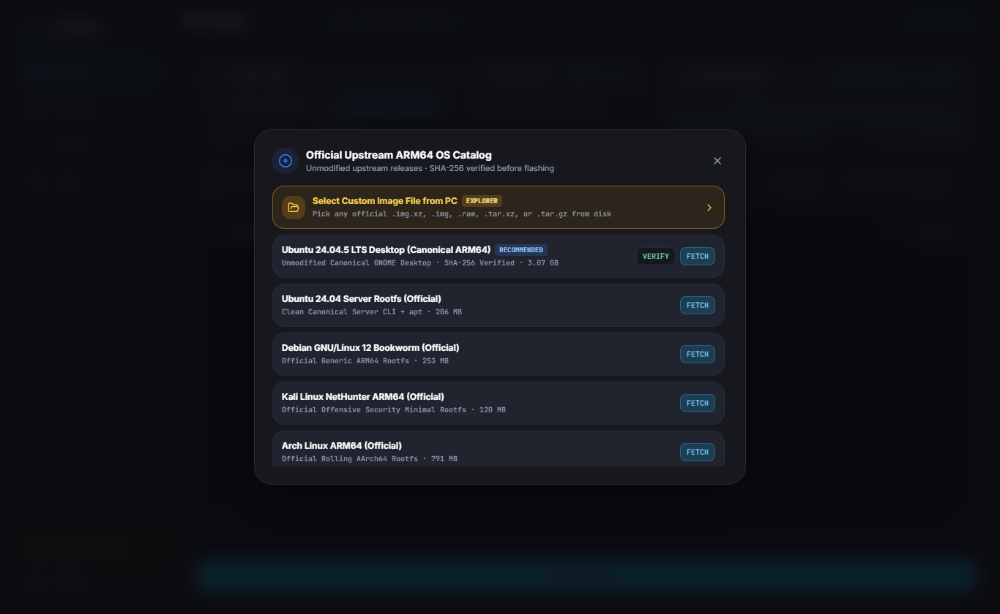
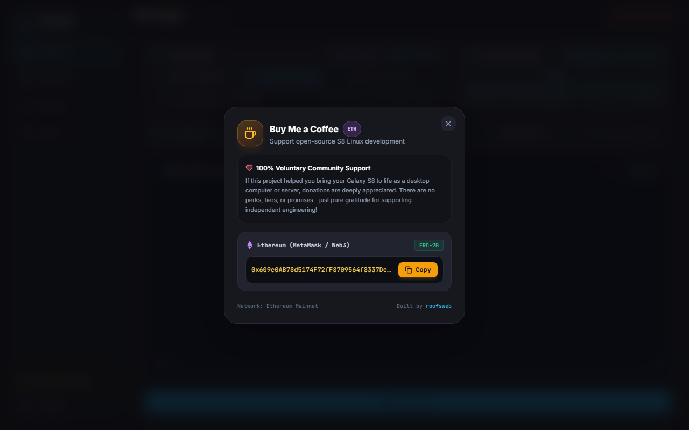

> [!WARNING]
> **WORK IN PROGRESS — PROJECT STILL UNDER DEVELOPMENT (ON HOLD AT `v1.0.0`)**
> This repository is **still under work** and remains experimental low-level firmware, kernel, and Linux bring-up software (currently paused on hold after milestone `v1.0.0`). Hardware support (`SM-G950N` Exynos 8895), tooling workflows, and documentation may contain rough edges or incomplete features — always inspect commands carefully and back up device partitions before flashing.

# Samsung Galaxy S8 (`SM-G950N`) — Native ARM64 Linux Platform (`4.4.111`)

> **[PROJECT STATUS — MILESTONE HOLD (`v1.0.0`)]**
> Development is currently **paused on hold** after completing the `v1.0.0` milestone: pure-Linux `switch_root -> systemd (PID 1)` AP firmware (`Galaxy_S8_Linux_AP.tar`), unmodified upstream ARM64 distro deployment (`S8 Imager`), wired/wireless Roufsweb Protocol (RWP) remote management, and the modular `galaxy-s8-hw` hardware support package (`.deb` + universal `.tar.gz`). All source code, build pipelines, release images, and documentation in this repository reflect the verified working state.

Convert a Samsung Galaxy S8 (`SM-G950N`, Exynos 8895 Octa-Core 64-bit, 4 GB LPDDR4x, 64 GB UFS 2.1) — including **headless salvaged units with broken or removed OLED screens** — into a native ARM64 Linux desktop, server, or homelab appliance without modifying the upstream operating system distribution.

**[Live Project Documentation & Architecture Page (`galaxy-s8.roufsweb.com`)](https://galaxy-s8.roufsweb.com/)** | **[Releases (`v1.0.0`)](https://github.com/roufsweb/galaxy-s8/releases/tag/v1.0.0)** | **[Full Credits](CREDITS.md)**


*Unmodified Canonical Ubuntu 24.04.5 LTS ARM64 (`systemd` as `PID 1`) running on Linux `4.4.111-s8-native-linux` with `galaxy-s8-hw v1.0.0`, GNOME 46, and Plank Dock.*

---

## Table of Contents

1. [Kernel & Hardware Capability Infographic](#1-kernel--hardware-capability-infographic)
2. [Prerequisites, Used Phone Preparation & OEM Unlock](#2-prerequisites-used-phone-preparation--oem-unlock)
3. [Physical Button Combinations (Wired, Recovery, Normal & Cold Reset)](#3-physical-button-combinations-wired-recovery-normal--cold-reset)
4. [Flashing the AP Package via Odin (`boot.img` + TWRP `recovery.img`)](#4-flashing-the-ap-package-via-odin-bootimg--twrp-recoveryimg)
5. [Flashing Unmodified Linux Distros Using `S8 Imager` (Step-by-Step Visual Guide)](#5-flashing-unmodified-linux-distros-using-s8-imager-step-by-step-visual-guide)
6. [Post-Flash Access: USB RNDIS, SSH, Terminal & Wi-Fi Setup](#6-post-flash-access-usb-rndis-ssh-terminal--wi-fi-setup)
7. [Installing the Device Hardware Package (`galaxy-s8-hw` v1.0.0)](#7-installing-the-device-hardware-package-galaxy-s8-hw-v100)
8. [Hardware Controls, Physical Buttons, Desktop Access & DisplayPort](#8-hardware-controls-physical-buttons-desktop-access--displayport)
9. [Building Release Artifacts from Source & Verification](#9-building-release-artifacts-from-source--verification)
10. [Credits & Attributions](#10-credits--attributions)
11. [Buy Me a Coffee (Voluntary Support)](#11-buy-me-a-coffee-voluntary-support)

---

## 1. Kernel & Hardware Capability Infographic

All Linux distributions run atop the verified **DEFEX-free Samsung Exynos 8895 Linux `4.4.111-s8-native-linux`** kernel compiled safely for EL2 TrustZone CFP compatibility (`# CONFIG_RKP_CFP is not set`), paired with an **LZMA pure-Linux BusyBox initramfs** (`sda7`) and **TWRP 3.7.0** (`sda8`).


### Verified Kernel (`kernel/.config`) & Silicon Capabilities

| Subsystem | Kernel Config / Hardware Node | Verified Runtime Capability |
| :--- | :--- | :--- |
| **SoC & Big.LITTLE CPU** | Exynos 8895 ARM64 (`CONFIG_PREEMPT=y`, `CONFIG_ARM64_VA_BITS=39`) | `4x Exynos M2 @ 2.314 GHz` + `4x Cortex-A53 @ 1.690 GHz` |
| **GPU & Hardware Codecs** | Mali-G71 MP20 (`Bifrost`), `CONFIG_VIDEO_EXYNOS_MFC=y` | 20 shader cores @ `546 MHz` + Exynos MFC hardware H.264/HEVC (`/dev/video6..9`) |
| **Memory & ZRAM Swap** | 4 GB LPDDR4x + `CONFIG_ZRAM=y`, `CONFIG_CRYPTO_LZ4=y` | `~3.6 GB` usable physical RAM + `2 GB` LZ4 compressed ZRAM swap |
| **Security & `glibc 2.39`** | `# CONFIG_SECURITY_DEFEX is not set`, `# CONFIG_RKP_CFP is not set` | Unlocks modern Ubuntu 24.04+ / Debian 12 / Arch `glibc` without Samsung binary kills |
| **Containers & Networking** | `CONFIG_NAMESPACES=y`, `CONFIG_CGROUPS=y`, `CONFIG_OVERLAY_FS=y`, `CONFIG_VETH=y`, `CONFIG_BRIDGE=y`, `CONFIG_TUN=y`, `CONFIG_NETFILTER=y`, `CONFIG_NF_NAT=y`, `CONFIG_IP_NF_IPTABLES=y` | Full Docker Engine, LXC containers, VPN/WireGuard tunnels, NAT bridges, firewalls (`aid_inet`/`3003`, `aid_net_raw`/`3004`, `aid_net_admin`/`3005` auto-configured by `galaxy-s8-hw`) |
| **Storage & Filesystems** | `CONFIG_EXT4_FS=y`, `CONFIG_F2FS_FS=y`, `CONFIG_VFAT_FS=y`, `CONFIG_FUSE_FS=y`, `CONFIG_MMC_DW=y` | `64 GB` UFS 2.1 (`sda24` `~53.7 GB` usable formatted ext4 without `^extents` issues) + `mmcblk0` MicroSD (`/media/sdcard`) *(Note: `CONFIG_NTFS_FS` is disabled)* |
| **USB Gadget & Ethernet** | `CONFIG_USB_CONFIGFS_RNDIS=y`, `CONFIG_USB_HID=y`, `CONFIG_USB_NET_AX88179_178A=y` | Plug-and-play USB RNDIS Ethernet (`192.168.7.2`), USB keyboard/mouse HID, USB3 Gigabit adapters |
| **Display Output (`DECON2`)** | `/dev/graphics/fb2` (`# CONFIG_VT is not set`, `# CONFIG_FRAMEBUFFER_CONSOLE is not set`) | `1080p60` USB-C DisplayPort / HDMI via `exynos_dp_bridge` (`fb2` kept blanked when unplugged to prevent DECON2 VSYNC watchdog panic; Type-C DFP `source` role + SBU `"0 0"`) |
| **Camera ISP Panic Guard** | Boot init + udev `99-s8-no-fimc.rules` | Removes uninitialized `/dev/video100+` (`fimc_is_ixs_video_querycap` NULL dereference guard on desktop/GStreamer probes) |
| **Power & Fast Charge** | `CONFIG_CHARGER_MAX77865=y` (`/sys/class/power_supply/max77865-charger/data`) | Register unlock (`0xBD`, `0xC3`, `0xC0`, `0xB9`, `0xB7`): `1,500 mA` fast charging + `4.3V` UVLO brownout protection |
| **Audio DSP & Amplifiers** | `CONFIG_SND_SOC_SAMSUNG_ABOX=y`, `CONFIG_SND_SOC_MAX98506=y`, `CONFIG_SND_SOC_MADERA=y` | Calliope ABOX DSP (9 firmwares embedded in `boot.img` ramdisk), `hw:0,0` Speaker amp (`MAX98506`), `hw:0,9` Digital Mic (`CS47L92` DMIC1) |
| **Wireless & Cellular** | Broadcom `BCM4361` (`dhd` + `CONFIG_BT_BCM=y`), Shannon 359 LTE | Dual-band `2.4/5 GHz` Wi-Fi + Bluetooth 5.0 + `/dev/umts_ipc0` (`rmnet0..7`) |

---

## 2. Prerequisites, Used Phone Preparation & OEM Unlock

If you purchased a **used Samsung Galaxy S8 (`SM-G950N`)** or wiped stock Android, complete these checks **before** entering Download Mode:

### A. Used-Phone FRP, Stock Cleanliness & OEM Unlocking
1. **Verify Target Hardware**: Built and verified on **Samsung Galaxy S8 Korean (`SM-G950N`, Exynos 8895)**. Exynos global `SM-G950F` shares the SoC architecture, but Korean Rev 11 DTB (`0x50a6`) is tuned specifically for `SM-G950N`. Snapdragon (`SM-G950U/W`) models are **not supported**.
2. **Clear Previous Owner Accounts (FRP Lock)**: If buying second-hand with Android still booting, remove all Google and Samsung accounts from **Settings -> Accounts**, or perform a clean factory reset while signed out so Download Mode later shows **`FRP LOCK: OFF`**.
3. **Enable Developer Options & OEM Unlocking**:
   * Open **Settings -> About phone -> Software information** and tap **Build number** 7 times.
   * Open **Settings -> Developer options**.
   * Turn **ON** **`OEM unlocking`** and approve the bootloader wipe prompt.
   * Turn **ON** **`USB debugging`** (helpful if you also inspect headless Android via `scrcpy` or issue `adb reboot download`).
4. **RMM / KG `Prenormal` Gotcha on Used/Reset Phones**:
   * On recently wiped Exynos Samsung phones, **`OEM unlocking`** may initially be hidden inside Developer Options (`RMM State: Prenormal` in Download Mode).
   * To reveal **OEM unlocking**, connect the phone to Wi-Fi on Stock Android, check **Settings -> Software update -> Download and install** (or let it check in online with date/time synced), then revisit **Developer options** and enable **OEM unlocking**.
   * **Headless (No-Screen) Tip**: If the phone still runs Stock Android without a screen and USB Debugging is enabled, mirror and tap Developer Options on your PC using `scrcpy` over USB before wiping.

### B. Host PC Prerequisites (Windows 10 / 11)
* **Samsung Android USB Drivers** (`SAMSUNG_USB_Driver_for_Mobile_Phones.exe`) installed on Windows so Odin detects `COM` Download Mode and ADB/RNDIS interfaces.
* **Odin3 v3.14.1 or v3.14.4** (`Odin3.exe`).
* **Project Repository + Python 3.10+**:
  ```powershell
  git clone https://github.com/roufsweb/galaxy-s8.git
  cd galaxy-s8
  ```
  (All Python runtime dependencies and bundled Windows `adb.exe` live inside [desktop-app/](desktop-app/); run `pip install -r desktop-app/requirements.txt` if launching from source for the first time.)
* **Download `Galaxy_S8_Linux_AP.tar`** from **[Releases v1.0.0](https://github.com/roufsweb/galaxy-s8/releases/tag/v1.0.0)** (exact size `79,472,640 B`, SHA-256 `9f1fa748a6901bee612274e47f6b5e7d74ab9f11751a97504fe7f4afcaf6b721`).

---

## 3. Physical Button Combinations (Wired, Recovery, Normal & Cold Reset)

Because many boards in this project are **headless (`lcdtype=-1` — no OLED screen or front LED)**, rely on exact stopwatch hold durations and USB/haptic cues rather than looking at a screen:

| Target Mode / Action | Exact Button Combination & Timing | How to Verify State (Headless & Screened) |
| :--- | :--- | :--- |
| **Odin Download Mode** | Keep USB-C plugged into PC -> Hold **`Volume Down + Bixby + Power`** continuously for **11–13 seconds**, then release. *(No `Volume Up` press required with this wired 11–13s hold.)* | Odin log prints **`Added!!`**; Windows Device Manager shows Samsung Mobile USB Modem (`COMxx` / `PID_685D`). |
| **PMIC Hard Cold Reset** *(if SoC is frozen/unresponsive)* | Hold **`Volume Down + Bixby + Power`** for **30 seconds** -> release all for **1 second** -> immediately hold **`Volume Down + Bixby + Power`** for **11–13 seconds**. | Forces MAX77865 PMIC power-latch drop and re-enters Odin Download Mode reliably. |
| **Exit Download Mode / Force Reboot** | While in Download Mode, hold **`Volume Down + Power`** for **7 seconds**. | USB `PID_685D` disconnects cleanly and SoC cold-boots. |
| **Boot to TWRP Recovery (`sda8`)** *(Required for `S8 Imager` OS flashing)* | From powered off (or at the exact moment the phone resets): hold **`Volume Up + Bixby + Power`** together for **8–12 seconds**. Or from Linux/Android run `adb reboot recovery` or click **`TWRP Recovery`** in `S8 Imager`. | `adb devices` lists `ce10171ab3e9620804    recovery` (or your serial + `recovery`). `S8 Imager` status pill turns green **`Connected`**. |
| **Boot to AP Linux Mode (`sda7`)** | Power on normally (short-press **`Power`**) or let Odin/TWRP reboot normally without holding Volume Up. | Initramfs checks `sda24` `/data/linux/rootfs.img` and executes `switch_root -> /sbin/init`. Phone exposes USB RNDIS at **`192.168.7.2`** (or BusyBox rescue `telnet` `:2323` + 3x haptic if no OS image is flashed yet). |

---

## 4. Flashing the AP Package via Odin (`boot.img` + TWRP `recovery.img`)

`Galaxy_S8_Linux_AP.tar` (`79,472,640 B`) flashes **two partitions simultaneously** in one Odin pass without modifying bootloader (`BL`), modem (`CP`), or wiping `USERDATA` (`sda24`):
* **`boot.img` -> `/dev/block/sda7` (`BOOT`)**: `31,227,920 B` (under the strict `41,943,040 B` / `40.00 MB` UFS slot limit) containing the `4.4.111-s8-native-linux` kernel, DTB, Calliope 9 DSP firmwares, and pure-Linux `switch_root` + rescue initramfs.
* **`recovery.img` -> `/dev/block/sda8` (`RECOVERY`)**: `48,234,496 B` containing TWRP 3.7.0 with root ADB enabled for `S8 Imager`.

### Step-by-Step Odin Procedure
1. **Put the Galaxy S8 into Download Mode**: Hold **`Volume Down + Bixby + Power`** for **11–13 seconds** while plugged into your PC via USB-C. Verify Odin shows `ID:COM` highlighted and `Added!!`. (If inspecting a screened unit, confirm `OEM LOCK: OFF` and `FRP LOCK: OFF`.)
2. **Launch `Odin3.exe` as Administrator**.
3. **Verify Odin Options**:
   * Open the **Options** tab in Odin: **ONLY** keep **`F. Reset Time`** checked (optionally keep **`Auto Reboot`** checked if you plan to immediately catch TWRP on reboot; uncheck `Auto Reboot` if you prefer controlled manual button timing).
   * Make sure **`Re-Partition`** is **UNCHECKED**. Do **NOT** touch `BL`, `CP`, or `CSC` slots.
4. **Load AP Archive**: Click the **`AP`** button and select **`Galaxy_S8_Linux_AP.tar`**. Wait a few seconds while Odin verifies MD5/USTAR headers cleanly.
5. **Flash**: Click **`Start`**. Wait ~10–15 seconds for Odin to write `boot.img` (`sda7`) and `recovery.img` (`sda8`) until the top-left status box turns green **`PASS!`**.
6. **Post-Odin USB Re-Plug Rule (Windows)**: Windows USB host controllers often leave Download Mode (`PID_685D`) endpoints suspended right after **`PASS!`**. **Unplug and immediately re-plug the USB-C cable** whenever rebooting out of Odin so ADB or USB RNDIS re-enumerates cleanly.
7. **Choose What to Boot Next**:
   * **To Flash a Linux OS immediately -> Boot TWRP (`sda8`)**: Right as the device reboots (or after holding `Vol Down + Power` 7s from un-checked Auto Reboot), immediately hold **`Volume Up + Bixby + Power`** for **8–12 seconds** until `adb devices` reports **`recovery`**.
   * **Note if you boot normally (`sda7`) before flashing a Linux OS**: Because `/data/linux/rootfs.img` does not exist yet on a stock/fresh `sda24`, `boot.img` automatically enters **Fail-Safe Rescue Mode** (3x haptic pulses, USB RNDIS NIC at `192.168.7.2`, telnet on port `:2323`, red LED blink if present). Connect over telnet or power-cycle holding **`Volume Up + Bixby + Power`** to enter TWRP (`sda8`) and flash your OS.

---

## 5. Flashing Unmodified Linux Distros Using `S8 Imager` (Step-by-Step Visual Guide)

`S8 Imager` keeps **every Linux distribution 100% unmodified upstream**. Unlike custom repacked ROMs, **no proprietary blobs or altered userland trees are pre-baked** into downloaded images—only a minimal first-boot connectivity seed (USB RNDIS `192.168.7.2`, SSH, V4L2 camera guard, `/boot/firmware` fstab cleanup, hostname, and optional Wi-Fi credentials) is injected into `/data/linux/rootfs.img` on `sda24`.

### Launch the App
1. Ensure the Galaxy S8 is booted into **TWRP Recovery (`sda8`)** and connected via USB.
2. Double-click **`Launch_S8_Imager.bat`** in the project root (or run `python desktop-app\main.py`). The app opens at `http://127.0.0.1:8765`.


### Step-by-Step Flashing Workflow

1. **Confirm TWRP Connection**: The top-right status pill turns green **`Connected`** when `S8 Imager` detects TWRP ADB over USB.
2. **Choose an Unmodified Operating System (`Target Image`)**:
   * **Option A — Official OS Catalog**: Click **`Official OS Catalog`** to open the verified upstream catalog:
     * **Ubuntu 24.04.5 LTS Desktop (Canonical ARM64)** (`ubuntu-24.04.5-preinstalled-desktop-arm64.img.xz` — Recommended, includes full GNOME 46 desktop)
     * **Ubuntu 24.04 Server Rootfs** (`ubuntu-24.04-server-rootfs-arm64.tar.xz`)
     * **Ubuntu 24.04.5 Minimal Base** (`ubuntu-base-24.04.5-base-arm64.tar.gz`)
     * **Debian 12 Bookworm Generic ARM64** (`debian-12-generic-arm64.tar.xz`)
     * **Kali Linux ARM64 Minimal** (`kali-nethunter-rootfs-minimal-arm64.tar.xz`)
     * **Alpine Linux 3.20 Minirootfs** (`alpine-minirootfs-3.20.3-aarch64.tar.gz`)
     * **Arch Linux ARM** (`ArchLinuxARM-aarch64-latest.tar.gz`)
     Click **`FETCH`** to download straight into `distros/` and **`VERIFY`** to check the official **SHA-256** checksum before clicking the row to select it.
   * **Option B — Local File**: Click **`Select Image File...`** and browse to any `.img.xz`, `.img`, `.raw`, `.tar.xz`, or `.tar.gz` image on your PC.



3. **Set UFS Storage Allocation**: Drag the **`Storage Allocation`** slider (`4 GB` to `48 GB`, e.g., `16 GB` or `24 GB`). Remaining space on `/dev/block/sda24` (`~53.7 GB` total UFS 2.1 Userdata) stays available as host data space.
4. **Fill the `First-Boot Seed` Row**:
   * **Username**: e.g. `ubuntu` (creates user + sudo access or updates preinstalled user)
   * **Password**: password for both your Linux user and `root` SSH login
   * **Hostname**: e.g. `galaxy-s8`
   * **Wi-Fi SSID & Password (Optional)**: writes a NetworkManager / Netplan (`90-s8-wifi.yaml`) seed profile so Wi-Fi can onboard cleanly once `galaxy-s8-hw` or firmware loads, or leave blank and configure later in **Config**.
5. **Click `Flash Image`**: Watch **`Unified Flashing & Hardware Telemetry Log`** execute TWRP staging -> ext4 extraction/resize -> `/data/linux/rootfs.img` creation -> `e2fsck -fy` -> connectivity seed injection -> clean unmount (`100%`).
6. **Boot into Linux**: Switch to **`Dashboard`** and click **`Reboot Device`** (or run `adb reboot` in terminal). Do **not** hold Volume Up during reboot so S-Boot boots **`sda7` (`boot.img`)**, which mounts `/data/linux/rootfs.img` and calls `switch_root` straight into Linux `PID 1 systemd` (takes ~20–35 seconds on first systemd initialization).

---

## 6. Post-Flash Access: USB RNDIS, SSH, Terminal & Wi-Fi Setup

Once Linux finishes booting (`20–35s` after reboot), the phone automatically activates its **USB RNDIS virtual network interface (`192.168.7.2`)** and **SSH server (port `22`)** thanks to the connectivity seed—even **before** Wi-Fi or `galaxy-s8-hw` is configured!

### A. Getting Immediate Access Over USB (`192.168.7.2`)
* **`S8 Imager` Dual-Transport (`Connected`)**: `S8 Imager` detects `192.168.7.2:22` automatically via Roufsweb Protocol (RWP SSH) and switches the dashboard/terminal to live Linux OS telemetry.
* **Built-In Terminal (`S8 Imager -> Terminal`)**:
  * Use **`OS Root`** mode to run commands directly inside the booted Ubuntu/Debian/Kali/Arch/Alpine OS over USB RNDIS or Wi-Fi.
  * Switch to **`AP Base`** if you ever reboot into TWRP recovery and need raw recovery/partition shell access.
  * Built-in **`s8ctl Commands`** dropdown inserts hardware helpers once `galaxy-s8-hw` is installed.
* **Standard PC SSH Client (PowerShell / Windows Terminal / Linux)**:
  ```bash
  ssh ubuntu@192.168.7.2
  # or root login:
  ssh root@192.168.7.2
  ```
  *(Note: If Windows assigns `192.168.7.x` via DHCP automatically on the "Remote NDIS Compatible Device" adapter, `192.168.7.2` is reachable immediately. If Windows shows `169.254.x.x` on first plug-in, wait 5 seconds for `dnsmasq`/DHCP or set the PC RNDIS adapter IPv4 to `192.168.7.1 / 255.255.255.0`.)*


### B. Configuring Wi-Fi (`BCM4361` Dual-Band) & Identity/SSH Keys
Open **`S8 Imager -> Config`** (or run commands after installing `galaxy-s8-hw`, which supplies the BCM4361 Wi-Fi firmware parameters and `aid_inet` socket permissions):


1. **In `S8 Imager -> Config` (GUI Method)**:
   * Under **Network Onboarding**, click **`SCAN`** to list 2.4 GHz & 5 GHz SSIDs via Broadcom BCM4361.
   * Select your network, enter the WPA2/WPA3 password, and click **`APPLY & CONNECT WI-FI`**.
   * Verify **`Wi-Fi IP:`** updates from `Offline` to your LAN IP (e.g. `192.168.0.xxx`). Once on Wi-Fi, you can unplug the USB data cable and continue controlling the phone over Wi-Fi RWP/SSH!
   * Under **Device Identity & Access**, optionally update **Device Hostname (`APPLY`)**, paste your **`ssh-ed25519` / `ssh-rsa` Public Key (`INJECT`)** for passwordless SSH, or update the **System Password (`SET`)**.
2. **CLI Wi-Fi Method (via SSH or Terminal once `galaxy-s8-hw` is installed)**:
   ```bash
   sudo s8_wifi.py scan
   sudo s8_wifi.py connect "YourWiFiSSID" "YourWiFiPassword"
   # Or via standard NetworkManager:
   sudo nmcli dev wifi connect "YourWiFiSSID" password "YourWiFiPassword"
   ```

---

## 7. Installing the Device Hardware Package (`galaxy-s8-hw` v1.0.0)

Upstream Linux distributions do not ship Samsung Exynos 8895 charger register overrides, Calliope DSP routing, BCM4361 module loaders, or chassis button handlers. Instead of baking proprietary edits into distro images, **all hardware integration is packaged cleanly into `galaxy-s8-hw` (`v1.0.0`)**.

### What `galaxy-s8-hw` Installs & Configures
* **PMIC, Thermal, ZRAM & Camera Panic Guard (`s8-hardware.service`)**: Unlocks MAX77865 `1,500 mA` + `4.3V` UVLO brownout guard, disables `/dev/video100+` (`99-s8-no-fimc.rules`), loads Broadcom BCM4361 Wi-Fi firmware parameters, creates `2 GB` LZ4 ZRAM swap, mounts MicroSD (`/dev/block/mmcblk0` -> `/media/sdcard`), configures Calliope ABOX ALSA (`hw:0,0` speaker + `hw:0,9` mic via `/etc/asound.conf`), sets `APT::Sandbox::User "root"` + `Seccomp "false"` for `4.4.111` `apt`, and adds Android `PARANOID_NETWORK` groups (`aid_inet`, `aid_net_raw`, `aid_net_admin`, etc.) so `apt`, `curl`, `docker`, and desktop users have unrestricted networking.
* **Physical Chassis Buttons (`s8-buttons.service` + `99-s8-power.conf`)**: Disables abrupt `systemd-logind` single-tap shutdown and runs `s8_button_daemon` (`/dev/input/event3`).
* **USB-C Role, Gadget, BT, LED, DisplayPort & Time Sync**: `s8-typec.service` (enforces USB-C DFP `source` role), `s8-usb-gadget.service` (`192.168.7.2` RNDIS + DHCP), `s8-bluetooth.service`, `s8-led.service`, `s8-time-sync.service`, `s8-dp-bridge.service` (`exynos_dp_bridge`), plus `s8-vnc.service` (`:5901`) & `s8-novnc-ws.service` (`:6080`).
* **Unified Hardware CLI**: Installs `/usr/local/bin/s8ctl` and `/usr/bin/s8ctl`.

### Installation Methods (Choose Any Supported Path)

#### Method A — 1-Click Install Inside `S8 Imager` (Recommended)
1. Ensure the phone is booted into Linux and connected over USB RNDIS (`192.168.7.2`) or Wi-Fi (`Connected` status pill).
2. Open **`S8 Imager -> Config`**.
3. Locate the **`S8 Hardware Pack (galaxy-s8-hw)`** card (bottom-right).
4. *(Optional)* If your phone already has internet access (Wi-Fi or PC internet sharing) and you want browser remote desktop (`noVNC :6080` / `TigerVNC :5901`), tick **`Also install VNC / noVNC / OpenSSH packages when online`**.
5. Click **`INSTALL S8 PACK`**. `S8 Imager` pushes the `.deb` (for Ubuntu/Debian/Kali) or universal `.tar.gz` (for Arch/Alpine) over SSH, runs `dpkg -i` / `install.sh`, enables all services, and updates the badge to **`INSTALLED v1.0.0`**.

#### Method B — Manual `.deb` Installation (Ubuntu, Debian, Kali)
Download **`galaxy-s8-hw_1.0.0_arm64.deb`** (`303,442 B`, SHA-256 `5f0ad9e56a87a1cc246ff5916b89481113374d2e04ce73d91abee59d7a7947e5`) from [Releases v1.0.0](https://github.com/roufsweb/galaxy-s8/releases/tag/v1.0.0) (or build from [packages/galaxy-s8-hw/build_packages.py](packages/galaxy-s8-hw/build_packages.py)):
```bash
scp galaxy-s8-hw_1.0.0_arm64.deb root@192.168.7.2:/tmp/
ssh root@192.168.7.2 "dpkg -i /tmp/galaxy-s8-hw_1.0.0_arm64.deb && rm -f /tmp/galaxy-s8-hw_1.0.0_arm64.deb"
```
Verify installation:
```bash
cat /etc/s8-hw-version    # 1.0.0
s8ctl status
```

#### Method C — Universal `.tar.gz` Installation (Alpine, Arch Linux ARM, Any ARM64 Distro)
Download **`galaxy-s8-hw-1.0.0-arm64.tar.gz`** (`340,850 B`, SHA-256 `94bcbdbad5aad0e674e4643ef97500304869683b805ef7a60af29b3eac0b5cfd`) from [Releases v1.0.0](https://github.com/roufsweb/galaxy-s8/releases/tag/v1.0.0):
```bash
scp galaxy-s8-hw-1.0.0-arm64.tar.gz root@192.168.7.2:/tmp/
ssh root@192.168.7.2 "tar -xzf /tmp/galaxy-s8-hw-1.0.0-arm64.tar.gz -C /tmp && cd /tmp/galaxy-s8-hw-1.0.0-arm64 && ./install.sh"
```
*(If VNC/OpenSSH packages were not installed yet, bring the device online via Wi-Fi and run `sudo /usr/local/bin/s8-vnc-setup.sh` at any time.)*

---

## 8. Hardware Controls, Physical Buttons, Desktop Access & DisplayPort


### Physical Button Daemon (`s8_button_daemon` in `galaxy-s8-hw`)
Verified timings in [src/drivers/s8_button_daemon.c](src/drivers/s8_button_daemon.c) (`systemd-logind` `HandlePowerKey=ignore` ensures accidental short taps never power off your server):

| Physical Button | Gesture / Hold Duration | Verified Behavior |
| :--- | :--- | :--- |
| **Power** | **Long Press (`>= 2.5s`)** | **Graceful Linux `poweroff`** with haptic confirmation |
| **Power** | **Double Press (`< 450ms`)** | **Graceful Linux `reboot`** with double haptic feedback |
| **Power** | **Short Press** | Display DPMS sleep / wake toggle (on `:1` X11) |
| **Volume + / -** | **Press** | ALSA Master volume up/down + crisp `35ms` haptic tick |
| **Bixby** | **Single Click (`<= 400ms`)** | Launches X11 terminal/console on `:1` |
| **Bixby** | **Double Click** | Toggles Rear Camera Torch LED (`torch-sec1`) |
| **Bixby** | **Triple Click** | Re-arms DisplayPort SBU switch (`0 0`), DFP role, and hotplug state |
| **Bixby** | **Long Press (`>= 1.2s`)** | Captures desktop screenshot and sends to configured Telegram bot (if `.env` configured) |

### Remote & Physical Desktop Viewing
* **In `S8 Imager -> Dashboard`**:
  * Monitor live **Octa-Core M2/A53 CPU clocks**, **LPDDR4x RAM**, **UFS + MicroSD (`mmcblk0`)**, **MAX77865 charge current + 4.3V UVLO**, **TMU Thermal Zones**, and trigger **Rear Torch**, **Haptic Pulse**, **Odin Mode**, **TWRP Recovery**, **Reboot Device**, or **`Device Screen`**.
* **Browser noVNC / VNC**: Once `s8-vnc-setup.sh` runs, open `http://192.168.7.2:6080` (or `http://<wifi-ip>:6080` / VNC port `:5901`).
* **Direct HDMI / DisplayPort Monitor (1080p60)**: Connect a USB-C DisplayPort/HDMI hub with external mouse/keyboard (`CONFIG_USB_HID=y`). `s8-dp-bridge.service` (`exynos_dp_bridge`) negotiates Type-C DFP role + SBU `"0 0"` and streams X11 display `:1` to `/dev/graphics/fb2` (`DECON2`) locked to `FBIO_WAITFORVSYNC`. Manual trigger: `sudo s8ctl dp on` or `sudo s8-dp`.

### `s8ctl` CLI Quick Reference
```bash
s8ctl status              # SoC clocks, RAM, MAX77865 charging, thermals, Wi-Fi, DisplayPort
s8ctl cpu performance     # Pin 4x M2 (2.314 GHz) + 4x A53 (1.690 GHz)
s8ctl gpu boost           # Lock Mali-G71 MP20 to 546 MHz
s8ctl battery             # Re-assert MAX77865 1500mA + 4.3V UVLO registers
s8ctl audio test          # Calliope ABOX + MAX98506 test tone (440 Hz)
s8ctl dp status           # Inspect DECON2 fb2 & HDMI switch state
s8ctl sdcard              # Inspect /dev/block/mmcblk0 mount at /media/sdcard
s8ctl torch toggle        # Toggle rear LED torch
s8ctl haptic 150          # 150ms haptic pulse
```

---

## 9. Building Release Artifacts from Source & Verification

Reproduce the release binaries or run automated repository tests cleanly from your workstation:

```powershell
# 1. Build standalone pure-Linux initramfs boot image (requires base assets & checks <= 40 MB sda7 limit)
python scripts/build/build_native_linux_boot.py

# 2. Validate boot image structural integrity & zero-rogue-loop safety
python scripts/pre_flash_validator.py

# 3. Build galaxy-s8-hw .deb and universal .tar.gz inside WSL2 / ARM64 Linux (requires dpkg-deb & aarch64-linux-gnu-gcc)
python3 packages/galaxy-s8-hw/build_packages.py

# 4. Run Privacy & Secret Sanitization check
python scripts/sanitize_repo.py

# 5. Run Desktop App CI/CD Verification Gates
python desktop-app/scripts/ci_cd_validator.py
```

Key architectural documentation files in [`docs/`](docs/):
* [docs/AP_AND_KERNEL_BUILD_GUIDE.md](docs/AP_AND_KERNEL_BUILD_GUIDE.md) — Partition tables, EL2 CFP toolchain rule, kernel `.config` flags, cold reset specs
* [docs/OS_MANAGEMENT_AND_FLASHING.md](docs/OS_MANAGEMENT_AND_FLASHING.md) — UFS storage architecture (`sda7`, `sda8`, `sda24` `^extents`), hardware nodes
* [docs/UNIVERSAL_DISPLAY_AND_CONSOLE_ARCHITECTURE.md](docs/UNIVERSAL_DISPLAY_AND_CONSOLE_ARCHITECTURE.md) — DECON2 `fb2` architecture and `CONFIG_VT` rules
* [docs/SENSORS_GUIDE.md](docs/SENSORS_GUIDE.md) — Sensor and peripheral hardware reference

---

## 10. Credits & Attributions

This project builds upon years of open-source mobile kernel engineering, bootloader research, and ARM64 Linux ecosystem work:

* **Project Creator & Maintainer**: **Abdur Rouf ([roufsweb](https://github.com/roufsweb))**
* **Galaxy S8 Mainline / Downstream Linux Pioneers**: **`boerck`**, **`jcadduono`**, **`osm0sis`**, **Jesec**, **Ananjaser1211**, **Corsicanu**, **Noxxxious**, and **Ace42** (XDA Exynos 8895 developers, TWRP device tree, and Android Boot Image tooling)
* **Upstream Operating Systems**: **Canonical Ltd.** (Ubuntu ARM64), **Debian Project**, **Offensive Security** (Kali Linux), **Alpine Linux**, **Arch Linux ARM**
* **Desktop & Tooling Ecosystem**: **GNOME Project**, **Vince Liuice** (WhiteSur GTK4/Shell themes), **Plank Dock**, **TigerVNC**, **noVNC**, **Team Win Recovery Project (TWRP)**, **topjohnwu** (Magisk `magiskboot`), **Docker**, **CasaOS**, **Ollama**, **Code-Server**
* **Hardware Vendors**: **Samsung** (Exynos 8895 / S-Boot / UFS / DECON), **Maxim Integrated** (`MAX77865`, `MAX98506`), **Cirrus Logic** (`CS47L92`), **Broadcom** (`BCM4361`)

Full detailed license notes and acknowledgments are maintained in [CREDITS.md](CREDITS.md) and released under the [MIT License](LICENSE).

---

## 11. Buy Me a Coffee (Voluntary Support)



If this project helped you rescue a Galaxy S8 or turn salvaged mobile hardware into a working Linux desktop or server, voluntary contributions are appreciated. There are **no tiers, perks, or expectations**—just appreciation for independent open-source hardware engineering.

* **Ethereum (ETH / ERC-20 / MetaMask Mainnet)**:
  ```text
  0x609e0AB78d5174F72fF8709564f8337DebEa5BD7
  ```
* Also accessible directly inside **`S8 Imager`** via the bottom-left **Buy Me a Coffee** sidebar button.
