# Galaxy S8 Native Linux — OS Management, AP Components & Flashing Architecture (`docs/OS_MANAGEMENT_AND_FLASHING.md`)

> [!IMPORTANT]
> **COMPREHENSIVE SUBSYSTEM & DEPLOYMENT SPECIFICATION:**
> This document details the operating system architecture, the hardware components exposed by the Application Processor (AP), and the end-to-end flashing pipelines for the headless Samsung Galaxy S8 (`SM-G950N`, Exynos 8895).

---

## 1. Operating System Architecture & Storage Layout

The Galaxy S8 Native Linux environment operates via a hybrid native container/chroot architecture running on top of our DEFEX-free Exynos 8895 Linux 4.4.111 kernel.

### 1.1 Dual-Storage Geometry
* **Primary UFS 2.1 Storage (`/dev/block/sda`):**
  * `sda7` (`BOOT`): 40.0 MB (`41,943,040` B) — Holds kernel + CPIO ramdisk with embedded Calliope DSP firmwares.
  * `sda8` (`RECOVERY`): 40.0 MB (`41,943,040` B) — Exact fail-safe twin of `sda7` (or TWRP for flashing).
  * `sda17` (`SYSTEM`): Read-only vendor firmware store (`/system/vendor/etc/wifi/`, `/system/vendor/firmware/`). Never wiped; mounted read-only at boot to provision BCM4361 Wi-Fi/BT firmware.
  * `sda24` (`USERDATA`): ~53.7 GB — Formatted as clean Ext4 (`mkfs.ext4 -O ^extents -F`). Holds `/data/linux/rootfs.img` (Single-OS `Rule 26`).
  * `sda10` (`RADIO`): Holds Shannon 359 baseband modem firmware.
  * `sda3` (`EFS`): NVRAM calibration and cellular identity.
* **Secondary MicroSD Expansion (`/dev/block/mmcblk0`):**
  * Host Controller: Synopsys DesignWare MMC (`11500000.dwmmc2`).
  * Auto-mounted at `/media/sdcard` and bind-mounted to `/mnt/android_data/sdcard` with `umask=000`.
  * Accessible across FileBrowser, desktop managers, and `s8ctl sdcard`.

### 1.2 Ext4 Formatting Requirement (`^extents`)
Samsung's downstream UFS drivers on 4.4 vendor kernels exhibit corruption when ext4 extent trees undergo massive continuous writes during rootfs extraction.
* **Mandatory Format Flag:** `mkfs.ext4 -O ^extents -F /dev/block/sda24` (and `-O ^extents` on `/data/linux/rootfs.img`).
* **Result:** Eliminates extent-related filesystem corruption, guaranteeing clean journal replays (`e2fsck -p`) in under 200ms even after sudden battery disconnects.

---

## 2. Every Component Exposed from the AP (Application Processor)

The AP layer (`boot.img` / `recovery.img` + ramdisk) exposes essential hardware controls and drivers to userland:

### 2.1 Power & Thermal Subsystem
| Node / Register | Function | Operational Setting |
| :--- | :--- | :--- |
| `/sys/class/power_supply/max77865-charger/data` | PMIC Direct Registers | `0xBD 0x6C` (Unlock), `0xC3 0x61` (UVLO 4.3V), `0xC0 0x3C` (1500mA limit), `0xB9 0x9E` (1500mA fast charge), `0xB7 0x05` (Mode buck/chgr) |
| `/sys/class/power_supply/battery/batt_tune_input_charge_current` | Input Charge Cap | `1500` (mA) |
| `/sys/class/power_supply/battery/batt_tune_fast_charge_current` | Fast Charge Cap | `1500` (mA) |
| `/sys/class/thermal/thermal_zone0/temp` | SoC Thermal Sensor | Core junction temperature in milli-degrees Celsius |

### 2.2 CPU & GPU Performance Engine
| Node / Path | Subsystem | Verified Values / Profiles |
| :--- | :--- | :--- |
| `/sys/devices/system/cpu/cpu[0-3]/cpufreq/scaling_cur_freq` | 4x Cortex-A53 Efficiency Cores | Pinned at 1.690 GHz (`performance` governor) |
| `/sys/devices/system/cpu/cpu[4-7]/cpufreq/scaling_cur_freq` | 4x Exynos M2 Custom High-Perf Cores | Pinned at 2.314 GHz (`performance` governor) |
| `/sys/kernel/gpu/gpu_clock` | Mali-G71 MP20 (20 Shader Cores) | Boosted to 546 MHz |

### 2.3 Display & Video Pipelines
| Node / Interface | Role | Operational Rule |
| :--- | :--- | :--- |
| `/dev/graphics/fb2` (`DECON2`) | USB-C DisplayPort Output | Keep in `FB_BLANK_POWERDOWN` while `state == 0`. Unblank only when `state == 1` to prevent kernel panic. |
| `/sys/class/switch/hdmi/state` | DisplayPort Hotplug State | `0` = Disconnected, `1` = Monitor Connected |
| `/sys/class/dp_sec/dp_sbu_sw_sel` | DisplayPort SBU Analog Switch | `0 0` (or `1 0` flipped) enables AUX switch (`gpio_sw_oe = 0`, active low) and powers `VDD_DP_3P3`. |
| `/sys/class/typec/port0/port_type` | Type-C CCIC Port Role | Force `source` to present Rp resistors, preventing DFP negotiation deadlock. |
| `/dev/video6..9` | Exynos MFC Codecs | Hardware H.264 / HEVC decode & encode acceleration. |
| `/dev/video100..220` | V4L2 Camera ISP Nodes | **MUST BE REMOVED** at boot (`rm -f /dev/video[1-9][0-9]*`) to prevent NULL-deref panic. |

### 2.4 Audio & Haptic Telemetry
| Node / Interface | Component | Configuration |
| :--- | :--- | :--- |
| ALSA `hw:0,0` | Maxim MAX98506 Speaker Amplifier | Routed via Calliope DSP (`SPK out`, Speaker Gain 25) |
| ALSA `hw:0,9` (WDMA1) | Cirrus Logic CS47L92 Digital Mic 1 | Ambient microphone audio capture |
| `/etc/firmware/` & `/vendor/firmware/` | 9 Calliope DSP Firmware Blobs | SRAM, DRAM, IVA, DSM, and SLSI acoustic tuning tables |
| `/sys/class/timed_output/vibrator/enable` | Haptic Motor | Duration in ms (35ms button click, 150ms state notify) |
| `/sys/class/leds/torch-sec1/brightness` | Rear Camera Flash LED | `0` = Off, `10` = Full Torch |

### 2.5 Input & Cellular Interfaces
| Node / Interface | Subsystem | Action |
| :--- | :--- | :--- |
| `/dev/input/event3` (`gpio_keys`) | Physical Chassis Buttons | Power, Volume Up, Volume Down, Bixby |
| `/dev/umts_ipc0`, `/vendor/bin/cbd` | Shannon 359 Cellular Baseband | CP Boot daemon `-tss333 -bs -ml` with 8 LTE interfaces (`rmnet0..7`) |

---

## 3. End-to-End Flashing Pipelines

The project supports three distinct flashing pipelines depending on deployment needs:

```mermaid
flowchart TD
    subgraph Odin_Deployment ["1. Odin AP Slot Flashing (Windows GUI)"]
        O1["Hold VolDown + Bixby + Power (11-13s)"] --> O2["Enters Odin Mode (PID_685D on COM17)"]
        O2 --> O3["Load Galaxy_S8_Linux_AP.tar into AP Slot"]
        O3 --> O4["Odin flashes boot.img (sda7) & recovery.img (sda8)"]
        O4 --> O5["Post-Flash USB Re-plug (Restores ADB endpoints)"]
    end

    subgraph Desktop_App ["2. S8 Imager Zero-Fork Upstream Deployment (GUI)"]
        D1["Launch_S8_Imager.bat"] --> D2["Select Local ARM64 OS Image (BYOI: .img.xz / .tar.xz)"]
        D2 --> D3["Set First-Boot User & Storage Slider (4-48 GB)"]
        D3 --> D4["Click Flash Image"]
        D4 --> D5["Extract MBR/GPT ext4 Slice & Write /data/linux/rootfs.img"]
        D5 --> D6["Inject Minimal Connectivity Seed (USB RNDIS 192.168.7.2 + SSH)"]
        D6 --> D7["Reboot to Linux & Click INSTALL S8 PACK (galaxy-s8-hw)"]
    end

    subgraph Live_ADB ["3. Live Terminal Flashing (Direct /tmp/ DD)"]
        L1["adb push scratch/boot_ubuntu_autoboot.img /tmp/boot.img"]
        L1 --> L2["dd if=/tmp/boot.img of=/dev/block/sda7 bs=4096 conv=fsync"]
        L2 --> L3["dd if=/tmp/boot.img of=/dev/block/sda8 bs=4096 conv=fsync"]
        L3 --> L4["rm /tmp/boot.img && sync"]
    end
```



### 3.1 Pipeline 1: 1-Click Odin AP Deployment
* **Package:** [`releases/Galaxy_S8_Linux_AP.tar`](file:///e:/rouf/galaxy-s8/releases/Galaxy_S8_Linux_AP.tar) (~80.5 MB).
* **Target:** Overwrites `sda7` (`BOOT`) and `sda8` (`RECOVERY`).
* **Pre-requisite:** Phone in Download Mode (`PID_685D`).
* **Execution:** Standard Odin v3.14.4 `AP` slot flash.

### 3.2 Pipeline 2: S8 Imager Zero-Fork Upstream Deployment Engine
* **Engine:** [`desktop-app/app/core/flasher.py`](file:///e:/rouf/galaxy-s8/desktop-app/app/core/flasher.py) + [`desktop-app/app/core/injector.py`](file:///e:/rouf/galaxy-s8/desktop-app/app/core/injector.py).
* **Procedure:**
  1. **Pre-flight & Storage Allocation:** Verifies TWRP recovery ADB connection, checks free space on `/dev/block/sda24`, and removes previous OS (`/data/linux/rootfs.img`) per Single-OS `Rule 26` while preserving `/data/linux/vendor_fw` firmware backups.
  2. **Partition / Archive Preparation:** For `.img.xz` / `.raw` desktop disk images, parses MBR/GPT headers natively in Python to stream out the Linux `ext4` partition and expands it to the requested size (`truncate` + `resize2fs`). For `.tar.xz` / `.tar.gz` archives, allocates a clean `-O ^extents` `/data/linux/rootfs.img` loop image and unpacks cleanly.
  3. **Minimal Connectivity Seed (`Rule 27`):** Writes ONLY the minimum needed for headless first-boot reachability: ConfigFS USB RNDIS (`192.168.7.2/24`), static `s8-dropbear-arm64` SSH fallback, `99-s8-no-fimc.rules` V4L2 panic guard, `aid_inet` socket groups, `/boot/firmware` fstab guard, and `oem-config -> graphical.target` switch when `oem-config` is present without `/dev/tty1`.
  4. **Post-Boot `galaxy-s8-hw` Pack:** Once booted over USB RNDIS (`192.168.7.2`), S8 Imager installs `galaxy-s8-hw_1.0.0_arm64.deb` (or `.tar.gz`) via `dpkg -i`, enabling PMIC 1500mA fast charging, Calliope audio, physical buttons (`logind` power long-press >= 2.5s), DisplayPort, and NetworkManager Wi-Fi.

### 3.3 Pipeline 3: Live Direct DD Flash
* **Procedure:** Used for fast iterative kernel/ramdisk testing when ADB is already connected, requiring zero reboots into Odin mode.

---

## 4. Vanilla Stock OS Flashing Mandate & Modular Layering

### 4.1 The Vanilla Stock Distribution Mandate
To ensure maximum flexibility and reliability, the S8 Native Linux platform enforces the **Vanilla Stock OS Mandate**:
* Base operating system images (`.tar.xz`, `.img.gz`, `.raw`, `.qcow2`) are downloaded **untouched and untampered** directly from upstream distribution releases (Ubuntu Base Rootfs, Debian Minimal, Alpine Linux, Arch Linux ARM, Kali Linux).
* **Zero OS Bloat:** No custom system binaries, modified systemd units, or vendor rootfs bloatware are pre-baked into distribution archives.
* Any stock ARM64 distribution supported by the Linux 4.4 kernel boots directly.

### 4.2 Why Phones Differ from Single Board Computers (SBCs)
Unlike standard SBCs (e.g., Raspberry Pi, Orange Pi, Rockchip boards) which feature simple hardware rails (fixed 5V input, onboard hardwired Wi-Fi, passive audio DACs), high-end mobile phones like the Galaxy S8 require active software orchestration for hardware survival:
1. **Power & Battery Management:** Standard USB ports default to 450–500mA without software enumeration. The MAX77865 PMIC registers must be actively written to unlock 1,500mA fast charging and prevent battery starvation under CPU load.
2. **Type-C Dual-Role & DisplayPort:** The CCIC chip defaults to UFP (Sink). DisplayPort Alt Mode requires actively forcing DFP mode (`port_type = source`), enabling the SBU analog switch, and clocking DECON2.
3. **Broadcom BCM4361 Wi-Fi:** Requires injecting vendor NVRAM and CLM calibration parameters into `/sys/module/dhd/parameters/` at boot.
4. **Calliope DSP Audio:** Requires loading 9 separate DSP firmwares into ABOX SRAM/DRAM before ALSA endpoints become functional.

### 4.3 Modular Post-Boot Provisioning
Rather than modifying the base OS image, all phone-specific features are provisioned **modularly after boot**:
```
+-------------------------------------------------------------+
|               Vanilla Stock OS Rootfs (Noble / Bookworm)   |
|               (Zero Vendor Bloat, 100% Upstream)           |
+-------------------------------------------------------------+
                              ▲
                              │ Mounted at /mnt/ubuntu
+-------------------------------------------------------------+
|         Post-Boot Hardware Supervisor (/data/linux/)        |
|  - PMIC 1500mA Fast-Charge & UVLO Unlock                    |
|  - BCM4361 Wi-Fi Provisioning (connect_wifi.sh)             |
|  - V4L2 ISP Panic Guard Removal                             |
|  - Calliope DSP & ALSA Routing (Speaker & DMIC1)            |
|  - Type-C DisplayPort Hotplug Daemon (exynos_dp_bridge)     |
|  - S8 Hardware Center Management Daemon (s8ctl)             |
+-------------------------------------------------------------+
                              ▲
                              │ Auto-boot on sys.usb.ffs.ready=1
+-------------------------------------------------------------+
|             Application Processor (AP) Golden Kernel        |
|          Exynos 8895 Linux 4.4.111 + CPIO Ramdisk           |
+-------------------------------------------------------------+
```
Configurations (Wi-Fi network credentials, battery charging limits, display modes, CPU governor profiles) can be adjusted dynamically at any time via the **S8 Imager Desktop Application**.

---

## 5. Roufsweb Protocol (RWP) & Device Transport Contract

### 5.1 Dual-Shell Architecture
The platform exposes two distinct execution contexts:
1. **OS Root (`/mnt/ubuntu`):** Full Ubuntu userland environment with glibc 2.39, apt package management, GNOME desktop, Docker, and standard Linux utilities.
2. **AP Base (Android Recovery / Kernel):** The foundational Android init environment (`/sbin/`, `/system/bin/`) providing direct access to raw block devices (`/dev/block/sda*`), kernel sysfs nodes, PMIC registers, and modem IPC.

### 5.2 Dual-Transport Channels
| Channel | Medium | Protocol | Port | Characteristics |
| :--- | :--- | :--- | :--- | :--- |
| **Wired USB ADB** | Physical USB-C Cable | Android ADB Protocol | `5037` (Host) | Ultra-reliable, zero network dependency, unbrick recovery access. |
| **Wi-Fi RWP Transport** | 802.11ac (BCM4361) | Roufsweb Protocol (SSH / WebSocket) | `22` / `6080` | High-throughput wireless terminal & telemetry, untethered mobile operation. |

### 5.3 Fallback & Transport Invariants
* The S8 Imager desktop app and backend API automatically detect transport availability.
* If Wi-Fi is unreachable, the system gracefully routes terminal commands and telemetry through the Wired USB ADB transport.
* All background daemons escape cgroup termination using `echo $$ > /acct/tasks`.

---

## 6. 3-Step CI/CD Verification Protocol

Every code change, kernel build, or UI modification must pass the strict 3-step verification protocol:


1. **Step 1: Backend Logic & REST APIs**
   * Static syntax compilation and linting.
   * Unit tests for `DeviceManager`, `Flasher`, and telemetry parsers.
   * REST API contract testing (`/api/status`, `/api/flash`, `/api/exec`, `/api/screen`).
2. **Step 2: Frontend UI & DOM Interactions**
   * Bento grid layout adherence and responsive CSS validation.
   * Playwright agentic E2E human-flow simulation testing.
   * Restrained UX enforcement: no prompt leakage, state-driven CTA buttons, zero text bloat.
3. **Step 3: Device Transport & RWP Contract**
   * Live physical device execution when connected (`ce10171ab3e9620804`).
   * Deterministic zero-latency offline simulation when disconnected.
   * Verified transmission of both Wired USB ADB and Wi-Fi RWP streams.

