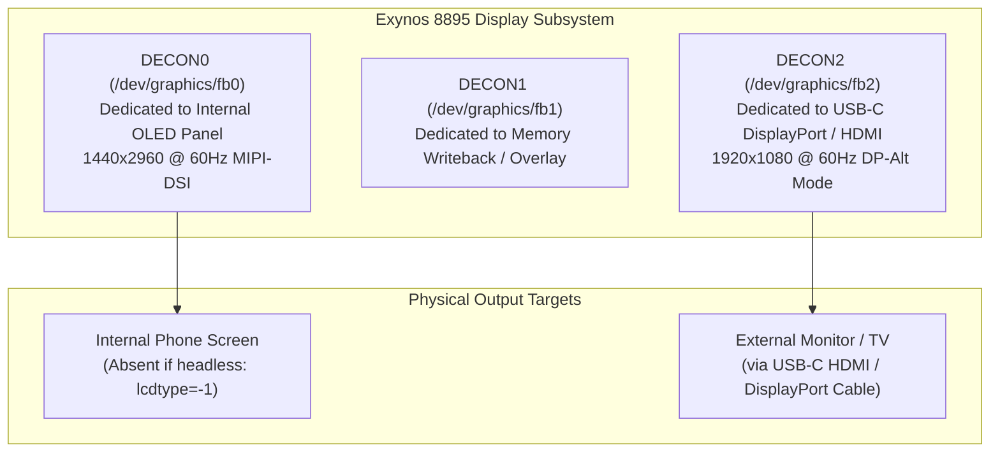
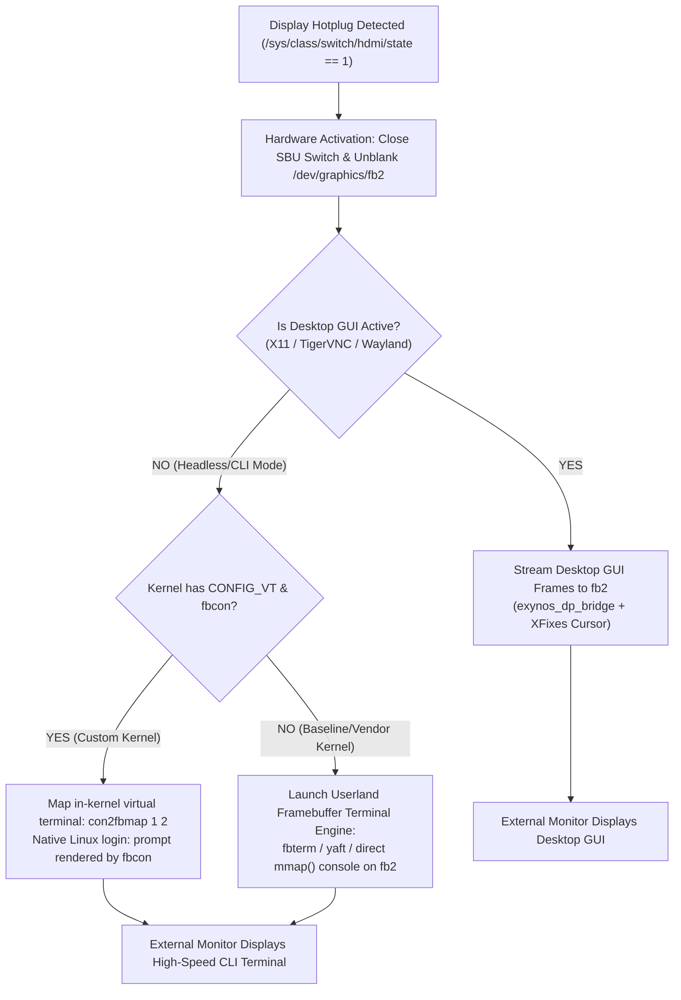
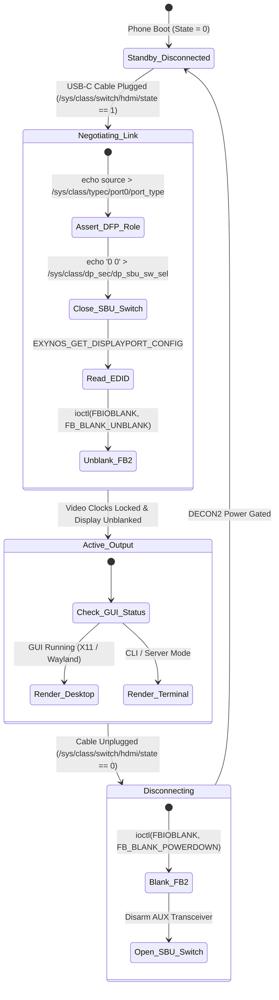

# Samsung Galaxy S8 (Exynos 8895) — Universal Display & CLI Console Architecture (`docs/UNIVERSAL_DISPLAY_AND_CONSOLE_ARCHITECTURE.md`)

> [!IMPORTANT]
> **AUTHORITATIVE MASTER REFERENCE & ANTI-HALLUCINATION SPECIFICATION:**
> This document defines the universal display and text-console architecture for the Samsung Galaxy S8 (`SM-G950N`, Exynos 8895, `dreamlteks`).
> It specifies how the platform delivers display output across **internal mobile screens**, **external USB-C DisplayPort/HDMI monitors**, and **pure headless CLI terminal modes** without requiring a desktop GUI.

---

## 1. Hardware Architecture: The 3 Exynos DECON Display Controllers

The Samsung Exynos 8895 SoC contains three independent Display Execution Controller (DECON) hardware pipelines, each mapped to a distinct Linux framebuffer device:



### Framebuffer Node Assignments
| Node Path | Controller | Physical Connection | Resolution / Timings | Status on Headless S8 |
| :--- | :--- | :--- | :--- | :--- |
| `/dev/graphics/fb0` (or `/dev/fb0`) | `DECON0` | Internal MIPI-DSI OLED Panel | $1440 \times 2960 \text{ @ } 60\text{ Hz}$ | Non-functional when screen is physically removed (`lcdtype=-1`). |
| `/dev/graphics/fb1` (or `/dev/fb1`) | `DECON1` | Internal Writeback / Overlay | Dynamic DMA Buffer | Used for hardware composition / offscreen blits. |
| `/dev/graphics/fb2` (or `/dev/fb2`) | `DECON2` | USB-C DisplayPort Alternate Mode | Negotiated via EDID ($1080\text{p}60$, $4\text{K}30$, $720\text{p}$) | Active external monitor output channel. |

---

## 2. The Android Kernel Trap: Why Text Consoles Fail Out-of-the-Box

On standard Linux x86_64 PCs, Raspberry Pis, and server platforms (Debian, Ubuntu Server, Proxmox), plugging in a monitor immediately displays a text console (`login:` prompt) because:
1. The kernel enables the Virtual Terminal subsystem (`CONFIG_VT=y`).
2. The kernel enables the Framebuffer Console (`CONFIG_FRAMEBUFFER_CONSOLE=y`, or `fbcon`).
3. The display hardware is wired to `/dev/fb0`, and `fbcon` binds to `fb0` automatically on boot.

### The Exynos Vendor Kernel Reality
In Android stock vendor kernels (including Samsung's Exynos 8895 downstream 4.4 tree and TWRP recovery kernels):
```ini
# CONFIG_VT is not set
# CONFIG_VT_CONSOLE is not set
# CONFIG_FRAMEBUFFER_CONSOLE is not set
```
* **Why Android Disables Them:** Android uses userland `SurfaceFlinger` for all drawing and has no concept of Linux virtual terminals (`/dev/tty1` .. `/dev/tty63`). Samsung explicitly stripped `fbcon` and `CONFIG_VT` from the defconfig to reduce kernel size and prevent text consoles from disrupting the Android boot animation.
* **The Missing Driver Trap:** If an AI agent or developer tries to run `con2fbmap 1 2` or spawn `/sbin/agetty tty1` on a stock/TWRP kernel without these flags, the command fails with `No such device` or `ioctl(FBIOPUT_CON2FBMAP) failed`.

---

## 3. The 2-Tier Universal Solution

To achieve universal display output across **all distributions** (whether running a custom kernel or a baseline kernel, and whether running with or without a GUI), we employ a **2-Tier Architecture**:



### Tier 1: Userland Pure Framebuffer Terminal Engine (Universal Across All Kernels)
* **How It Works:** A lightweight userland terminal emulator (such as `fbterm`, `yaft`, or a custom C framebuffer console daemon) opens `/dev/graphics/fb2` directly, maps the memory buffer with `mmap()`, and renders text glyphs using an embedded bitmap or FreeType font.
* **Kernel Requirements:** **None** beyond standard `/dev/fb*` support (`CONFIG_FB=y`). Works on 100% of vendor, stock, TWRP, and custom kernels.
* **Performance:** Sub-millisecond character redraws, full UTF-8 and ANSI color support, consumes less than $5\text{ MB}$ of RAM.
* **Shell Integration:** Spawns `/bin/login -f root` or `/bin/bash` directly inside the terminal window. Connecting a USB keyboard allows direct physical control of the system on any TV or monitor without network or PC access.

### Tier 2: In-Kernel Virtual Terminal (`fbcon` for Custom Kernel Builds)
* **Kernel Requirements:**
  ```ini
  CONFIG_VT=y
  CONFIG_VT_CONSOLE=y
  CONFIG_FRAMEBUFFER_CONSOLE=y
  CONFIG_FRAMEBUFFER_CONSOLE_ROTATION=y
  ```
* **Mechanism:** When compiled with these flags using the Samsung GCC 4.9 CFP toolchain, the Linux kernel creates `/dev/tty1` through `/dev/tty63`.
* **Dynamic Console Switching:** Calling `con2fbmap 1 2` redirects the virtual console from the (missing) internal screen (`fb0`) to the external DisplayPort monitor (`fb2`).

---

## 4. Hardware State Machine & Dynamic Hotplug Specification

The universal display supervisor daemon operates according to the following strict hardware state machine:



### Strict Kernel Panic Guard (Finding 8 / Rule 8)
> [!CAUTION]
> **NEVER** write frames to or call `S3CFB_WIN_CONFIG` on `/dev/graphics/fb2` while `/sys/class/switch/hdmi/state == 0` (cable disconnected).
> Without an active DisplayPort pixel clock and VSYNC signal from an attached monitor, the Exynos 8895 DECON2 shadow-update register times out (`DISP_ERR_DECON_TIMEOUT`) and panics the kernel (`panic("DISPLAY: DECON:2: ERROR")`).
> The supervisor must keep `fb2` in `FB_BLANK_POWERDOWN` until `state == 1` is verified.

---

## 5. Implementation Architecture Across System Layers

### 5.1 In the Odin AP Slot & Ramdisk (`boot.img`)
1. **Device Node Symlinks (`init.rc`):**
   Expose standard Linux framebuffer paths so userland utilities don't require Android `/dev/graphics/` path hacks:
   ```rc
   symlink /dev/graphics/fb0 /dev/fb0
   symlink /dev/graphics/fb2 /dev/fb2
   ```
2. **Early DisplayPort SBU Arming:**
   Ensure SBU analog switches and AUX power rails are armed during early boot so third-party USB-C to HDMI adapters negotiate without requiring a cold cable re-insertion.

### 5.2 In Custom Kernel Builds (`defconfig`)
Enable native virtual terminals and framebuffer console for compile-time support:
```ini
CONFIG_VT=y
CONFIG_VT_CONSOLE=y
CONFIG_HW_CONSOLE=y
CONFIG_FRAMEBUFFER_CONSOLE=y
CONFIG_FRAMEBUFFER_CONSOLE_DETECT_PRIMARY=y
CONFIG_FRAMEBUFFER_CONSOLE_ROTATION=y
```

### 5.3 In Userland (`start_all.sh` / Master Supervisor)
1. **Detection & Launch:**
   The supervisor launches in the background at boot across all distributions (Ubuntu, Kali, Alpine, OpenWrt).
2. **Terminal Mode (Default CLI):**
   If no X11 server is detected on `:1` or `:0`, the supervisor launches the framebuffer terminal engine on `fb2`, binding it to a root login shell.
3. **GUI Mode (Desktop):**
   If TigerVNC or X11 is running, the supervisor automatically switches to streaming the desktop with hardware mouse cursor overlay.
4. **Hotplug Seamless Transition:**
   Unplugging the cable gracefully blanks `fb2`. Re-plugging instantly restores the terminal or desktop within $200\text{ ms}$.

---

## 6. Anti-Hallucination Guidelines for AI Agents

When authoring or modifying code for the Galaxy S8 display subsystem, AI coding agents MUST follow these 5 non-negotiable rules:

1. **Never Assume `/dev/fb0` is the External Monitor:** `/dev/fb0` is hardwired to the internal mobile OLED panel. The external USB-C DisplayPort output is strictly `/dev/graphics/fb2` (or `/dev/fb2`).
2. **Never Call `con2fbmap` Blindly Without Checking `CONFIG_VT`:** Stock Samsung and TWRP kernels do not contain in-kernel `fbcon`. Always verify `grep CONFIG_VT /proc/config.gz` or provide the userland framebuffer terminal fallback (`fbterm` / direct `mmap`).
3. **Never Forget SBU Switch Negotiation:** Third-party HDMI dongles do not trigger Samsung proprietary CCIC Alternate Mode automatically. Always write `echo "0 0" > /sys/class/dp_sec/dp_sbu_sw_sel` before attempting to read EDID or unblank `fb2`.
4. **Never Leave `fb2` Unblanked on Cable Disconnect:** Always issue `ioctl(fd, FBIOBLANK, FB_BLANK_POWERDOWN)` when `/sys/class/switch/hdmi/state == 0` to prevent DECON2 timeout panics.
5. **Always Support Dual Fallback:** If an internal screen is present (`lcdtype != -1`), output to `fb0`; if an external display is connected, output to `fb2`; if both are present, support mirroring or dual console mapping.

