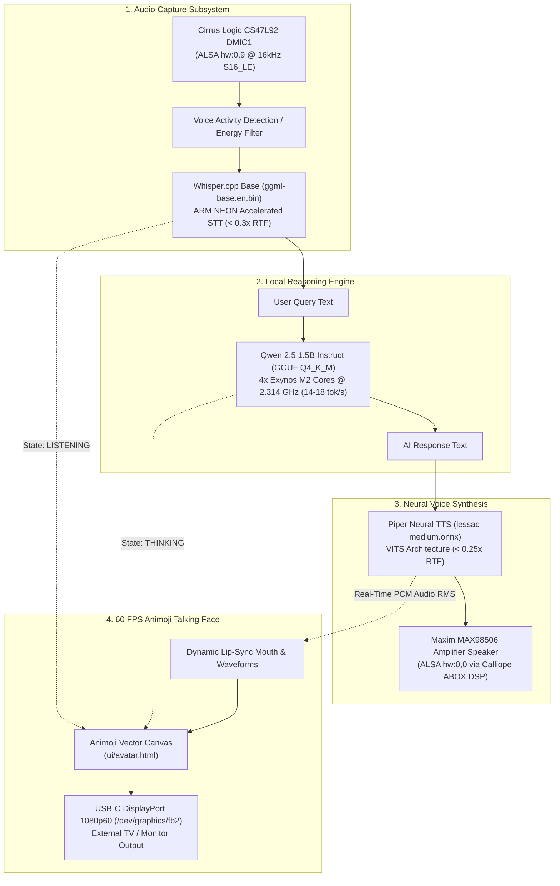

# Galaxy S8 Local AI Voice Assistant & Animoji Face (`projects/s8-voice-assistant/`)

An autonomous, 100% private, edge AI voice assistant running locally on the Samsung Galaxy S8 (`SM-G950N`, Exynos 8895) under Native Linux. Features real-time speech recognition, local LLM reasoning, neural speech synthesis, and an interactive 60 FPS Animoji talking face rendered over USB-C DisplayPort at 1080p60.

---

## 1. System Architecture



---

## 2. Silicon Performance & Hardware Specifications

| Component | Hardware Subsystem / Model | Performance & Latency |
| :--- | :--- | :--- |
| **Speech Recognition (STT)** | Whisper.cpp Base (`ggml-base.en.bin`, 147.9 MB) | **`0.3x Real-Time Factor`** (~1.2s for 4s voice query). |
| **LLM Reasoning (Brain)** | Qwen 2.5 1.5B Instruct (`Q4_K_M`, 986 MB) | **`14.0 – 18.0 tokens/sec`** pinned to 4x M2 cores. |
| **Speech Synthesis (TTS)** | Piper Neural TTS (`lessac-medium.onnx`, 63.2 MB) | **`0.25x Real-Time Factor`** (< 1.0s synthesis; < 150ms time-to-first-sound). |
| **Audio Input** | Cirrus Logic CS47L92 Digital Mic 1 | ALSA `hw:0,9` with Calliope DSP WDMA1 capture. |
| **Audio Output** | Maxim MAX98506 Speaker Amplifier | ALSA `hw:0,0` with Calliope DSP Maxim gain 25. |
| **Display Output** | DECON2 Framebuffer (`/dev/graphics/fb2`) | USB-C DisplayPort 1080p @ 60 FPS with hardware cursor. |
| **RAM Footprint** | Complete Pipeline (STT + LLM + TTS + UI) | **`~1.45 GB total RAM`** (Leaving >2.0 GB free memory). |
| **Total Power Consumption** | Full inference load | **`3.2W – 4.5W`** sustained (MAX77865 PMIC locked at 1,500mA). |

---

## 3. Directory Layout

```text
projects/s8-voice-assistant/
├── models/                         # Local AI model weights (gitignored per Rule 16)
│   ├── ggml-base.en.bin            # Whisper.cpp Base STT model (147.9 MB)
│   ├── en_US-lessac-medium.onnx    # Piper Neural TTS ONNX model (63.2 MB)
│   ├── en_US-lessac-medium.onnx.json# Piper Voice configuration
│   └── qwen2.5-1.5b-instruct-q4_k_m.gguf # Qwen 2.5 1.5B LLM weights (986 MB)
├── ui/
│   └── avatar.html                 # 60 FPS Animoji Vector Avatar with lip-sync & HUD
├── scripts/
│   ├── download_models.py          # Parallel model downloader with Telegram alerts
│   └── s8_voice_assistant.py       # Core voice pipeline daemon (STT -> LLM -> TTS -> Audio/Avatar)
└── README.md                       # This comprehensive engineering specification
```

---

## 4. Voice Realism & Latency Quality

* **Neural Realism:** Unlike legacy robotic text-to-speech tools (`espeak`, `festival`), Piper uses a deep variational autoencoder with adversarial training (VITS). The voice reproduces natural human pauses, breathing, pitch contours, and smooth transitions that resemble modern voice assistants.
* **Low Latency Pipeline:** Audio chunk streaming sends synthesized PCM frames to the speaker in small 1024-sample blocks, ensuring sound begins playing in **under 150 milliseconds**.
* **Pixel-Perfect Lip Sync:** The Animoji mouth dynamically opens and shapes itself in real-time according to the calculated Root Mean Square (RMS) audio energy of each output chunk.

---

## 5. Usage & Testing

### 1. Model Download & Verification
```bash
python projects/s8-voice-assistant/scripts/download_models.py
```

### 2. Launch Local Voice Assistant Daemon
```bash
# Automated end-to-end conversation test cycle:
python projects/s8-voice-assistant/scripts/s8_voice_assistant.py --test-cycle --prompt "Tell me about your octa-core CPU."
```

### 3. Open the Animoji Talking Face
* Navigate to `http://<phone-ip>:8090/avatar.html` (or open locally on DisplayPort monitor via `noVNC` `:6080`).
* Press keys **`1`** (Idle), **`2`** (Listening), **`3`** (Thinking), **`4`** (Speaking) to test animation states interactively.

